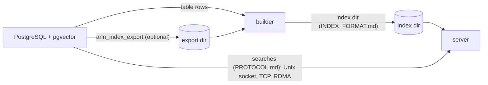

# ANN: GPU search for PostgreSQL

Three parts, built and deployed separately:

| Folder | What | Builds with | Deploys to |
| --- | --- | --- | --- |
| [server/](server/README.md) | The ANN server, `ann-worker` and `ann-worker-cuvs`: loads index directories and answers searches from PostgreSQL | `make -C ann/server [USE_CUVS=1]` | The database host, or GPU nodes reached over TCP/RDMA |
| [builder/](builder/README.md) | `build_cuvs_index.py`: builds index directories from a table or an export | `pip install -r ann/builder/requirements-gpu.txt` | Any host with the database (or the export) and a GPU for CAGRA shards |
| [common/](common/) | The filter language (`filter.c`, `filter.h`) and cost model (`cost.h`) compiled into both the server and the PostgreSQL extension, and the index format | — | — |

The contracts between them:

- [common/INDEX_FORMAT.md](common/INDEX_FORMAT.md): the index directory the builder (and `ann_index_export`) writes and the server loads.
- [server/PROTOCOL.md](server/PROTOCOL.md): the requests PostgreSQL sends the server.

The PostgreSQL side (`src/ann*.c`, built by the top-level `Makefile`) needs neither the server's nor the builder's dependencies. Guides: [loaded cuVS indexes](../docs/ann-cuvs-index.md), [networked GPU nodes](../docs/ann-networked.md), [frozen indexes](../docs/ann-frozen-index.md).
