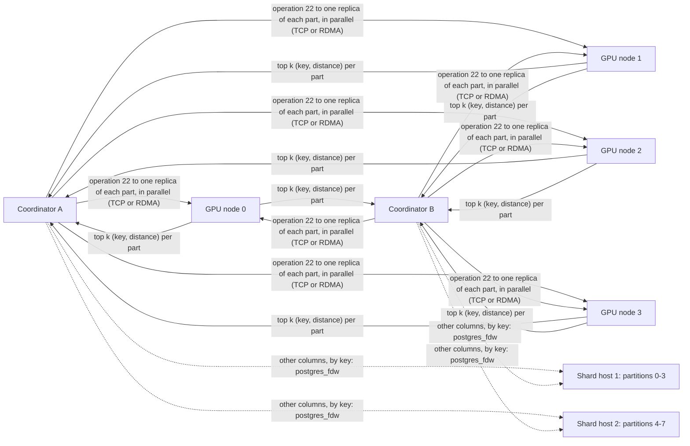

# Collections: one table served by many GPU nodes

A collection is a table whose rows are split into **parts**, each part a loaded ann index on its own GPU nodes, searched together by one call on any PostgreSQL host (a **coordinator**). It implements the core of the [sharded collections plan](ann-sharded-collections-plan.md): partitions on several PostgreSQL shard hosts, parts on several GPU nodes with replicas, placement by an attribute, and a coordinator that holds no rows.



## Usage

**1. Shard hosts:** each partition is a table frozen and indexed on its own host, then exported.

```sql
-- on the shard host holding partition 0 (keys 0 .. 2^28 - 1: tenants 0 .. 255)
CREATE TABLE docs_0 (id bigint, tenant int, category int, emb vector(1024));
COPY docs_0 FROM ...;
SELECT ann_freeze('docs_0');
VACUUM (FREEZE) docs_0;
CREATE INDEX docs_0_ann ON docs_0 USING ann (emb vector_l2_ops)
    INCLUDE (id, tenant, category) WITH (frozen = true);
SELECT ann_index_export('docs_0_ann', '/data/ann/exports/export-0');
CREATE INDEX ON docs_0 (id);       -- for fetching non-covering columns by key
```

**2. Parts:** the builder combines the exports of the partitions a part holds into one index, one CAGRA shard per partition. Partitions must be key ranges (their keys must not overlap); the combined keys stay sorted.

```sh
python3 scripts/ann/build_cuvs_index.py --dtype float16 --quantize nvfp4 --out /data/ann/idx/part-0 \
    --from-export /data/ann/exports/export-0 --from-export /data/ann/exports/export-1
```

**3. GPU nodes:** a worker per node, as for any [networked node](ann-networked.md).

```sh
ann/ann-worker-cuvs --backend cuvs --listen /run/ann.sock --listen-tcp 0.0.0.0:7700 \
    --auth-token-file /etc/ann/token --lanes 24 --itopk 64 --rdma mlx5_0:1 --rdma-lanes 4
```

**4. Coordinators:** the table the filters are written against (here partitioned, with `postgres_fdw` foreign partitions on the shard hosts), the collection, and its parts. `ann_collection_load` loads a part's directory on every node of its replica list, checks that all serve the same generation, and records it; with a NULL path it attaches a part already loaded (other coordinators).

```sql
CREATE TABLE docs (id bigint, tenant int, category int, emb vector(1024)) PARTITION BY RANGE (id);
CREATE FOREIGN TABLE docs_0 PARTITION OF docs FOR VALUES FROM (0) TO (268435456)
    SERVER shard1 OPTIONS (table_name 'docs_0');
-- ...

SELECT ann_collection_create('docs', 'docs', ARRAY['tenant', 'category'], placement => 'tenant');
SELECT ann_collection_load('docs', 0, 'docs_p0', '/data/ann/idx/part-0', 'gpu1:7700,gpu3:7700', 0, 511);
SELECT ann_collection_load('docs', 1, 'docs_p1', '/data/ann/idx/part-1', 'gpu2:7700,gpu4:7700', 512, 1023);
```

**5. Queries:**

```sql
-- the 10 nearest rows matching a filter over the collection's attributes
SELECT key, distance FROM ann_collection_search('docs', $1, 10, 'tenant = 42 AND category < 50');

-- other columns, fetched from the shard hosts by key (runtime pruning sends one query per shard with hits)
SELECT id, body FROM docs
WHERE id = ANY(ARRAY(SELECT key FROM ann_collection_search('docs', $1, 10, 'tenant = 42')));
```

## How a search runs

1. **Catalog.** The coordinator reads `ann_collection` and `ann_collection_part` once per backend (again after 10 s, or at once when a node answers that it serves another generation).
2. **Program.** The filter is translated once per backend into a [predicate program](ann-frozen-index.md#predicates) against the source table's columns, and cached by its text. Collection attributes are integer, boolean and date columns; text needs a dictionary shared by all parts and is refused.
3. **Placement.** When the collection is placed by an attribute, the coordinator runs the program over value ranges instead of rows: a leaf on the placement attribute gives its values, every other leaf all values, AND intersects, OR unites, NOT gives all values. Parts whose recorded range can't match are skipped. `tenant = 42`, `tenant IN (1, 900)` and `tenant BETWEEN 10 AND 20 AND category = 3` reach only the parts holding those tenants; `category = 3` reaches every part.
4. **Fan-out.** One operation-22 request per remaining part, all in flight at once: the coordinator keeps one connection per node, over RDMA when `ann.worker_rdma` is set, picks each part's replicas in rotation, and moves a request to the next replica when a node fails (a failed node is skipped for `ann.worker_retry_ms`). Each request carries the part's generation. Everything must answer within `ann.worker_timeout_ms`, or the statement fails.
5. **Merge.** Each part returns its top k by key; the coordinator keeps the k nearest overall.

A part's worker searches its shards as for any loaded index: one lane, every shard on its GPU, the per-shard tree merge, and same-filter grouping across concurrent searches.

## Catalog

| Table | Columns |
| --- | --- |
| `ann_collection` | name, source (the table filters are written against), attributes, placement attribute |
| `ann_collection_part` | collection, part, index name on the nodes, nodes (replicas, `host:port` list), generation, rows, placement range |

## Measured: 16M × 1024 on one B200 host split into nodes

The host stood in for a small cluster:

- **Shard hosts:** two PostgreSQL clusters, four partitions each. A partition holds 128 tenants and 2M rows: keys `tenant × 2^20 + i`, `category` uniform over 0–99, vectors clustered in a 16-dimensional latent space and projected to 1,024.
- **GPU nodes:** four worker processes, each pinned to 2 B200s and 24 cores, `--lanes 24 --itopk 64 --bitset-gather-limit 4000000`, on its own TCP port. RDMA ran from the coordinators' InfiniBand port to the workers' port, across the fabric.
- **Coordinators:** clusters A and B, 64 cores each, with pgbench on the same cores. Their `docs` table is partitioned with `postgres_fdw` foreign partitions on the shard hosts.

Three layouts of the same 8 partitions:

| Layout | Parts | Copies | Node requests per query | Per node |
| --- | --- | --- | --- | --- |
| full | 1 part of 16M rows (2 shards of 8M, one per GPU) | 4 | 1 | the whole collection |
| 2×2 | 2 parts of 8M (2 shards of 4M) | 2 | 2 (1 when the tenant is pinned) | half of it |
| split | 4 parts of 4M (2 shards of 2M) | 1 | 4 (1 when the tenant is pinned) | a quarter |

**Preparing the data:**

| Step | Time |
| --- | --- |
| Load a 2M × 1024 partition (`COPY` from the Python generator, 8 in parallel) | 12–14 min |
| Freeze and build its frozen index | 76–220 s (several at once per cluster) |
| `ann_index_export` (8.4 GB) | 13–32 s |
| Combine 8 exports and quantize to NVFP4 | 2 min |
| CAGRA build, FP16 dataset, one shard per GPU | 40–67 s per 2M rows, 49–81 s per 4M, 78–125 s per 8M |
| Load a part on a node | under a minute; a 36 GB part prewarmed in 0.07 s from the page cache |

A part directory holds 2.18 KB per row of CAGRA dataset and graph (FP16 dataset, graph degree 32), 0.58 KB of NVFP4 rows and scales, and 4 KB of `vectors.f32` for exact re-scoring.

**Recall@10** against exact top 10 merged from the shard hosts' own frozen indexes (10 queries): 1.000 for `tenant = 7`, `category = 3` and `category BETWEEN 30 AND 39` on every layout. Unfiltered: 1.000 on the split layout, 0.980 on the full and 2×2 layouts, whose 4M- and 8M-row graphs search an FP16 dataset with `--itopk 64`.

**Throughput.** Best QPS (both coordinators together) with p99 at most 30 ms, no failed statement, and every search answered within its 50 ms deadline (`ann.worker_timeout_ms = 50`). Clients swept from 128 to 2,048 in total. A new connection's first search also connects to every node and can take longer than 50 ms; it counts in the percentiles, under a 5 s `statement_timeout`.

| Workload | Layout | TCP: QPS (p99) | RDMA: QPS (p99) |
| --- | --- | --- | --- |
| unfiltered | full | 222,163 (10.6 ms) | 197,446 (3.7 ms) |
| | 2×2 | 160,931 (23.0 ms) | 87,185 (2.1 ms) |
| | split | 99,989 (20.6 ms) | 51,709 (5.0 ms) |
| `tenant = t` (0.1% of rows, one part) | full | 224,251 (5.4 ms) | 236,790 (1.6 ms) |
| | 2×2 | 225,834 (10.0 ms) | 237,604 (1.6 ms) |
| | split | 224,094 (11.2 ms) | 237,757 (1.6 ms) |
| `category = c` (1% of rows, every part) | full | 192,248 (25.9 ms) | 93,684 (3.9 ms) |
| | 2×2 | 145,775 (28.0 ms) | 101,291 (3.5 ms) |
| | split | 83,376 (19.8 ms) | 61,300 (3.1 ms) |
| `category BETWEEN` (10% of rows, every part) | full | 28,450 (27.2 ms) | 26,854 (28.2 ms) |
| | 2×2 | 63,918 (24.9 ms) | 59,805 (25.6 ms) |
| | split | 63,639 (25.8 ms) | 37,511 (9.2 ms) |
| non-covering: `tenant = t` plus `category` fetched through `postgres_fdw` | full | 26,645 (2.8 ms) | |

What the numbers show:

- **Pinned queries are coordinator-bound.** A tenant search reaches one part on every layout and ran at 224–238k QPS, about 112–119k per 64-core coordinator. More coordinators would raise it; the four nodes were not the limit.
- **For unfiltered queries, whole copies win.** One request to one node per query (full) beat two parts (161k) and four parts (100k) at the same GPU count, as the [plan's throughput model](ann-sharded-collections-plan.md#3-throughput-model) predicts: each part costs a request, a launch per shard and a merge.
- **Broad filters favour more, smaller parts.** 10% filters select 1.6M rows of a full copy but 400k of a split part; the exact scans' per-query work is the same in total, but each node scans less and same-filter groups form per part. 2×2 and split ran 10% at 64k against the full layout's 28k.
- **RDMA: lower latency; TCP for wide fan-out.** At the same load RDMA's p99 was 2–8× lower (tenant: 1.6 ms against 5–11 ms), and it reached its peak with fewer clients. For queries that reach one node (the full layout, pinned tenants) its peaks were within about 10% of TCP's. Across all RDMA runs, though, the total stayed near 200–240k frames per second (about 55k per node), against about 100k per node over TCP, so layouts that fan out to several nodes gained least. Use RDMA where a query makes one node request, and TCP for layouts that fan out.
- **RDMA tuning.** Worker RDMA lanes that wait on completion events (`--rdma-poll wait`) instead of spinning on the nodes' cores raised the 2×2 layout's unfiltered peak from 87k to 111–114k and the full layout's 1% filters from 94k to 139k; use it when the RDMA lanes share cores with the search lanes. The four-part layout stayed at about 50k through everything tried: 8 RDMA lanes per node instead of 4, waiting or spinning on the nodes, coordinators spinning for 2 ms instead of sleeping (ruling out completion interrupts), and a separate lock for the worker's RDMA peer table. The adapters themselves sent 1.8M 600-byte messages per second between the two ports with up to 16 queue pairs. The GPU side is not the limit: in equal 10-second runs of the four-part layout (512 clients), the nodes ran about the same number of GPU batches over both transports (575k over TCP, 614k over RDMA), but a batch held 7.3 searches over TCP and 3.2 over RDMA, because RDMA requests reached the nodes at half the rate and search lanes sat idle (`--delay-us 200` did not change it, since a lane only holds a batch while no other lane is idle). At 1–64 clients RDMA was as fast or faster (0.82–0.88 ms against 0.93–0.96 ms per four-part search). Under that load nothing was saturated over RDMA: the coordinators' cores were 32% busy (88% over TCP), the nodes' 53% (93%), and the GPUs 58–81% (96–99%), while a query took about 10 ms. Missed completion wakeups are ruled out (0.03% of the coordinator's waits ended in a poll timeout), and so is interrupt delay (coordinators spinning 2 ms changed nothing). Losses grow with the nodes a query reaches (1 node: 185–197k, 2: 111k, 4: 50k), which points to occasional per-request stalls on the RDMA path that the slowest of several nodes always hits. What stalls requests, between a coordinator posting a send and the node's RDMA lane handing over the frame, is not yet found; per-request timestamps on both sides are the next step, then queue-pair scaling (each backend holds one queue pair per node, thousands per adapter).
- **One shard per GPU.** The first build gave each partition its own shard (8 shards on a node's 2 GPUs); a node then searched four graphs per GPU per request, and the full layout served 38,564 unfiltered QPS. One shard per GPU raised it to 222k.
- **Thresholds are absolute rows.** With the default `--bitset-gather-limit` of 500,000, 10% filters over a full copy (1.6M rows) ran filtered CAGRA on every shard and missed the SLO at every client count; 4,000,000 keeps them on exact scans.

## Sizing a billion rows at 1,024 dimensions

From the per-row sizes and times above (*estimates*: only 16M rows were measured):

| Resource | Per row | Per billion rows | Layout |
| --- | --- | --- | --- |
| GPU memory: CAGRA FP16 dataset and graph, NVFP4 copy, keys | 2.76 KB | 2.8 TB per copy | about 60M rows fit a B200 (144 GB pool); 42M per GPU leaves room to swap a shard: 24 GPUs, three 8-GPU nodes per copy |
| Worker host memory: `vectors.f32`, NVFP4 copy, keys, attributes | 4.7 KB | 4.7 TB per copy | 1.6 TB per node of 333M rows: fits a 2 TB host with the predicate budget set to about 200 GB; an FP16 re-scoring copy would halve it |
| PostgreSQL: heap, frozen index with its vector copy, key index | 8.3 KB | 8.3 TB | e.g. 64 partitions of 15.6M rows over 4–8 shard hosts; `vectors = half` would save 2 KB per row |
| Index build | | | partitions freeze and export in parallel on their hosts; a 42M-row CAGRA shard takes about 7 minutes on one B200, so a copy builds in about 10 minutes on 24 GPUs |

Throughput per copy scales from the measured per-node rates:

- **Pinned filters** (tenants of about 15k rows, as measured): one node request and one part per query, the same work as measured. Capacity grows with nodes and coordinators: plan about 115k QPS per 64-core coordinator, and copies of the hottest parts.
- **Unfiltered:** a query searches all 24 shards on three nodes. A node searched about 55k requests per second per copy here with 2 shards per request; with 8 shards per request on 8 GPUs and graphs five times larger, plan 35–45k QPS per copy, and add copies (three nodes each) for more.
- **Broad filters:** a 1% filter selects 10M rows of a billion, 60 times the measured work per query; exact scans fall to a few thousand QPS per copy. Place by the attribute queries pin, or accept filtered CAGRA, whose recall on 42M-row graphs has to be measured first.

## Tests

`test/ann/test_collection.py` (part of `make -C ann check`; `ANN_PG_DSN`, superuser) runs three CPU workers as nodes on their own TCP ports and checks that the builder combines exports in key order and refuses overlapping members; that searches equal exact SQL over the partitioned table for every filter shape, query and k; that a pinned tenant reaches only its part and replicas share the requests; that a stopped replica is skipped and a part without a live node is an error; and the catalog's checks. `benchmarks/ann/collection_bench.py` generates, sets up, benchmarks and checks recall as above.

