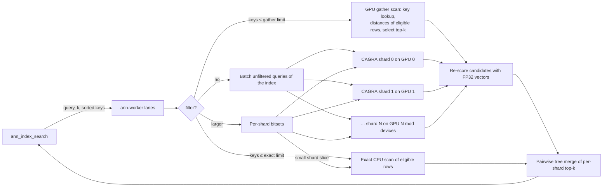

# Loaded cuVS indexes: sharded multi-GPU search from PostgreSQL

An offline Python script builds an immutable, sharded CAGRA index directory from a table. The C worker loads it across all GPUs, and two C SQL functions serve ANN and hybrid (filtered) queries. Everything on the query path is C: the PostgreSQL functions, the worker, and the cuVS adapter. Python is used only by the offline builder, tests and benchmarks.

## Quick start

```sh
# GPU host: build the worker with cuVS (default builds are CPU-only)
make -C ann USE_CUVS=1 CUVS_PREFIX=/path/to/libcuvs CUDA_HOME=/path/to/cuda
ann/ann-worker-cuvs --backend cuvs --listen /tmp/ann.sock --lanes 64

# offline build: one shard per visible GPU, FP16 dataset for bandwidth
python3 scripts/ann/build_cuvs_index.py --dsn 'dbname=app' --table public.docs \
    --key id --vector embedding --out /data/ann/docs --dtype float16
```

To build from a [frozen index](ann-frozen-index.md) instead of reading the table, export it with `SELECT ann_index_export('docs_ann', '/data/ann/docs-export')` and pass `--from-export /data/ann/docs-export` in place of `--dsn`, `--table`, `--key`, `--vector` and `--attribute`.

```sql
-- postgresql.conf: ann.worker_socket = '/tmp/ann.sock'
SELECT ann_index_load('docs', '/data/ann/docs');          -- superuser; returns rows loaded

-- ANN
SELECT d.* FROM ann_index_search('docs', $1, 10) s JOIN docs d USING (id) ORDER BY s.distance;

-- hybrid: any SQL predicate selects the eligible keys
SELECT d.* FROM ann_index_search('docs', $1, 10,
    ARRAY(SELECT id FROM docs WHERE tenant = $2 AND body @@ to_tsquery('english', $3))) s
JOIN docs d USING (id) ORDER BY s.distance;
```

`ann_index_search(name, query, k, filter bigint[] DEFAULT NULL)` returns up to `k` rows of `(id bigint, distance real)`, sorted by L2 distance. Distances are exact (FP32 vectors re-score every candidate), so they agree with `<->`. A NULL filter means no filter; an empty array, or one whose keys are all absent from the index, returns no rows. NULL elements are ignored.

## On-disk format

| File | Content |
| --- | --- |
| `manifest` | Text `key value` lines: `pgvector-ann-index 1`, `dimensions`, `rows`, `metric l2`, `dtype float32\|float16`, `source schema.table`, `shards N`, then `shard i first rows file` per shard, and `generation G` for directories built from a [frozen index](ann-frozen-index.md) export. Written last, so partial builds are never loadable. |
| `vectors.nvfp4`, `scales.e4m3`, `vectors.e4m3`, `rowscale.f32` | Optional (`--quantize nvfp4\|fp8`): a 4-bit or 8-bit copy of the vectors for the [Blackwell module](ann-blackwell.md), listed in the manifest as `quant nvfp4` or `quant fp8`. |
| `attr-COLUMN.i32` | Optional (`--attribute COLUMN`): one little-endian int32 per row in key order, listed in the manifest as `attribute COLUMN file`. See [filters resolved on the GPU node](ann-gpu-filters.md). |
| `keys.i64` | `rows` strictly increasing little-endian int64 table keys. Global ordinal *i* is the *i*-th smallest key. |
| `vectors.f32` | `rows × dimensions` little-endian FP32 vectors in key order. They're memory-mapped for the exact route and for re-scoring. |
| `shard-i.cagra` | CAGRA graph and dataset (`cagra.save(..., include_dataset=True)`) for ordinals `[first, first + rows)`. |

Shards are contiguous key ranges, so mapping a key to its shard is a binary search, and shard results never overlap. The worker validates the manifest, file sizes, key order, and each shard's dimensions and row count before registering the index.

**Immutability.** A directory is never modified, and the builder refuses a non-empty output directory. `ann_index_load` compares the source table's current row count with the manifest and refuses a stale index. Directories built with `--from-export` from a [frozen index](ann-frozen-index.md) carry its generation, a hash of every key, vector and attribute value, and load only while the table has a frozen `ann` index with that generation. After a table changes, build a new directory and load it under a new name. Joining results back to the table drops deleted keys, but rows added after the build are invisible. A loaded name stays until the worker restarts.

## Search execution



- **Lanes and devices.** A lane is a worker thread with its own cuVS resources, stream, workspace pool and buffers on every GPU. Shard *i* lives on GPU *i* mod the device count, or on every GPU with `--replicate on`. Requests from all PostgreSQL connections share one queue and one admission budget (`--max-pending-mb`).
- **Unfiltered batching.** A lane takes up to `--max-batch` queued queries. Unfiltered queries against the same index go to each shard as one query matrix. Each shard is searched asynchronously on its own GPU, then the lane synchronizes every device once.
- **Filtered queries.** Filters of at most `--exact-limit` keys (default 2,000) are scanned exactly on the CPU. Larger filters, up to `--gather-limit` keys (default 4,000,000), run a GPU gather scan, an exact search over only the eligible rows, like an inverted posting list scanned on the GPU:
  1. The lane splits the sorted keys at shard boundaries and copies each slice to its shard's GPU.
  2. A lookup kernel binary-searches each key in the shard's key array, which is kept in device memory.
  3. A gather kernel computes each eligible row's distance from the CAGRA dataset already on the device, one warp per row.
  4. `cuvsSelectK` picks the top k, and the worker re-scores those rows in FP32.

  Cost follows the number of eligible rows, not the shard size, and results are exact. Earlier load runs saw 3 hybrid answers in about 240,000 that lost one true neighbour: always the second of a close pair (ranks 4 and 5), replaced by the rank-11 row, as if the top-k selection had returned a candidate twice. It hasn't recurred in about 2M queries since (1.95M through PostgreSQL with 1,024 clients and 77k straight to the worker; 8-shard index, both allocators), and the code path is unchanged. As a guard, the worker checks each shard's selected positions for repeats; a shard that fails is scored again exactly on the CPU and logged (`repeated candidates in shard N`). The guard costs k² comparisons per shard and hasn't fired. The kernels are compiled at first use with NVRTC, which the worker opens at run time. If NVRTC is missing, or the gather limit is exceeded, the worker falls back to the earlier route: it maps the keys to ordinals, scans filters of up to 20,000 rows exactly, and otherwise runs CAGRA with a bitset of each shard's eligible rows. Each shard whose slice is at most the exact limit divided by the shard count is scanned exactly. Selective filters (under 25% of rows) raise the CAGRA internal top-k to `--filtered-itopk` (default 512). Bitset-filtered CAGRA runs multi-CTA with search width 4 by default, which raised recall at 1% from 0.67 to 1.0 ([details](ann-gpu-filters.md#filtered-cagra-settings)).
- **Host memory.** On Linux the worker reads `keys.i64` and `vectors.f32` into memory backed by transparent huge pages, instead of mapping them, and drops their page cache. Filtered lookups touch rows a page or more apart, so 4 KB pages cost a TLB miss per row. With huge pages, mapping 100k sorted keys to rows took 0.74 ms instead of 2.4 ms on the B200 host. Ordinal mapping also starts each key's search at the position its key gap predicts.
- **Merge.** The worker re-scores each shard's candidates with FP32 vectors, sorts them, and merges the shard lists pairwise, halving their number each round, down to the global top-k.

## FP16 distances

Rescoring cannot add a neighbour the graph search did not return; it only
reorders and re-measures the candidates. With the default `--filtered-slack 0`
a shard returns exactly k candidates, so FP32 rescoring leaves recall@k on
one shard unchanged. It changes recall only by picking k out of k + slack
overfetched candidates, or by changing which hits win the merge across shards.
Measured FP16 graph recall, with rescoring that therefore did not change the
sets: 0.985 unfiltered (1.0 for FP32), and a 0.988 mean (0.928 to 0.998) at
k=500 on 0.1–10% filters ([k=500 stress](ann-k500-stress.md)). Both meet a 95%
mean-recall target.

So by default FP16 indexes skip rescoring: graph searches return the FP16
dataset's squared-L2 distances (square-rooted), and quantized gather scans
rerank their NVFP4/FP8 candidates on the GPU from the FP16 dataset instead of
an FP32 copy. Returned distances then carry FP16 rounding error (the GPU tests
bound it at 0.01 on 32-dimensional data, against 1e-4 for FP32) and near-ties
may order differently from SQL. Use `--fp16-exact on`
when callers need exact distances or SQL's order: distance thresholds, ties,
or comparisons across indexes. Per-query gather scans still re-score on the
CPU from `vectors.f32` and stay exact either way. Statistics count native
FP16 graph queries as `cagra_fp16_queries`; `rerank_bytes` per replica shows
whether an FP32 copy is on the GPU.

## B200 throughput options

| Option | Effect |
| --- | --- |
| `--dtype float16` (builder) | Stores the CAGRA dataset in FP16: half the HBM traffic and footprint (8.5 GB vs 11 GB on disk for 10M×128). The worker converts queries to FP16. By default graph results keep their FP16 distances, and GPU reranking of quantized gather scans reads the FP16 dataset in place, so no FP32 copy goes to the GPUs; see [FP16 distances](#fp16-distances). |
| `--matrix-prune on\|off` (worker) | Matrix gathers of at least 65,536 eligible rows per shard select each query's k+slack candidates from the scores under a cutoff sampled from 8,192 of them (about four times the candidates needed pass), sorted in one block's shared memory, instead of a radix select over every row. A query whose cutoff keeps too few or too many falls back to full selection, so the candidates are the same. Default off; statistics `matrix_pruned_queries` and `matrix_prune_fallbacks`. On 10% filters at k=500 it took matrix gathers from 170k to 311k vectors/s ([measurements](ann-10pct-throughput.md)). |
| `ANN_KERNEL_TIMING=1` (worker environment) | Prints GPU stage times every 10 s: for the large-k scan, its candidate, copy, select and rescore stages; for the matrix gather, per-batch averages of scoring, residual masking, selection (sample, cutoff, compact, sort), reranking and the final top-k, timed with events on the first shard's stream. With several lanes per GPU the times include other lanes' kernels; run one lane per GPU for each stage's own time. Off by default. |
| `--gpu-predicates on\|off` (worker) | Predicates the cache misses are evaluated on a GPU (the CAGRA UDF interpreter over the single-valued attribute columns, one bitmap word per warp) instead of on the host; programs with stored-filter or multi-valued leaves stay on the host. A new result is not uploaded to the GPUs when it is cached: the lane that searches it copies its rows itself, and a repeated lookup uploads it to every copy, building the rows on each GPU from its bitsets. Default on (`off` evaluates new predicates on the host and uploads each result to every GPU at once); never-repeating 10% predicates went from 67k to 112k-144k vectors/s (64-vector arrays) and from 1.2k to 3.8-4.4k QPS (single-vector SQL) when it was added; with the later work in [the exploration roadmap](ann-filter-throughput-exploration.md#results-so-far) (ordinals-only entries, lane rows expanded from bitsets, residual masks) distinct predicates reach 765k vectors/s. Statistic `gpu_predicates`. |
| `--mixed-groups on\|off` (worker) | A lane whose same-filter group is short of its batch also takes queued searches over other cached filters, and searches whose filter appears once in the batch share one segmented gather: their GPU-resident row lists end to end, each row scored by its own query (NVFP4), per-query cutoffs as `--matrix-prune` (all rows kept for lists up to 16,384), FP32 GPU rerank. One-shard NVFP4 indexes with `--gpu-rerank on`. Default off: it helps when predicates rarely repeat (+45% on 991 distinct 1% windows) and costs throughput when they do (−25% on 91 overlapping 10% windows); statistic `mixed_queries`. |
| `--fp16-exact on\|off` (worker) | For FP16 indexes, rescore graph results in FP32 (on the GPU with `--gpu-rerank on`, else on the CPU) and rerank gathers from an FP32 copy on the GPUs (5.12 GB per replica for 10M×128): exact distances, at the cost of that memory and work. Default off. On FP16 indexes the worker's cost-profile routing applies only with it on, as their profiles were calibrated with FP32 rescoring; FP32 indexes take a profile calibrated on them. |
| `--itopk N` (worker) | CAGRA internal top-k for unfiltered queries, at most 512. This is the main recall/throughput dial. The default is 128; 64 kept recall@10 at 1.0 on the 10M benchmark below. |
| `--filtered-itopk N` | Internal top-k for selective filters: at most 512 with single-CTA search, 4096 with multi-CTA. |
| `--filtered-algo`, `--filtered-width`, `--filtered-iterations` | CAGRA algorithm (default `multi`), search width (default 4) and iteration limit for bitset-filtered searches. |
| `--bitset-min ROWS` | Attribute values with more rows get prebuilt per-shard bitsets (default 4,000,000). |
| `--memory-pool PERCENT` | Serve cuVS's temporary allocations from an RMM pool on each GPU, growing up to this share of its memory (default 80; index data is allocated from it too). `0` uses stream-ordered `cudaMallocAsync` instead, whose process-wide driver locks serialized concurrent searches: on 8 GPUs with 96 lanes the pool raised unfiltered ANN from 158k to 370k QPS and 10% filtered CAGRA from 6.6k to 102k ([details](ann-gpu-filters.md#scaling-across-gpus-and-hosts)). |
| `--device-allocator async\|plain` | `plain` makes cuVS allocate with `cudaMalloc`, without the pool. The pool reserves a quarter of its cap (21% of each GPU by default) at the first load, never shrinks, and keeps unloaded indexes' memory: three collection layouts on four 2-GPU nodes held 99.6 GB per GPU with the pool, 37.6 GB with `plain`, and unloading a 4M × 1024 index gave back all 5.3 GB per GPU it took with `plain` (630 MB, the CUDA context, stayed), against 1.1 of the 18.7 GB it took from the pool. The cost is unfiltered throughput: 165k against 222k QPS on the 16M collection; filtered searches were unchanged (tenant 234k, 1% filters 193k, 10% 62k). Use `plain` where indexes are loaded and replaced often or several workers share GPUs. |
| `--bitset-gather-limit ROWS` | Largest filter that arrives with a ready bitset (a cached bitmap, a sent bitmap, an attribute value with prebuilt bitsets) still sent to the gather scan (default 500,000); broader ones run filtered CAGRA. Key-list filters use `--gather-limit`, because their bitset would be built per query. |
| `--filter-lanes N`, `--active-lanes N` | Once `active-lanes` lanes (default three quarters of the lanes) work on cached filters, a filter gets at most `filter-lanes` lanes per GPU copy of the index (default 2); other searches over it wait behind them and are then scanned as one group. Below that, lanes start on any filter, so a few hot filters still fill the GPUs. See [same-filter grouping](ann-gpu-filters.md#same-filter-grouping). |
| `--canonical-predicates on\|off` (worker) | Predicates are cached and evaluated in a canonical form (`ann/canonical.h`): on a single-valued column every leaf becomes a set of the column's distinct values, so sorted and deduplicated value lists, ranges against the values they hold, values the column lacks, negation, NOT and AND/OR of leaves on one column all reach one entry; AND/OR operands are flattened and ordered, and leaves that match nothing or everything fold away. Default on. Never-repeating predicates whose unique part matched every row (`fresh10`) went from 143.9k to 773.7k vectors/s, the cached rate; a half-foldable mix (`mix10`) gained 65–73%; truly distinct predicates are unaffected. Statistic `predicate_canonical`. |
| `--residual-masks on\|off` (worker) | An AND predicate whose narrow operands remove few rows (operands on one single-valued column, at most 2^18 rows removed, such as `tenant <> 7`) is served from the cached entry of its other operands, with the removed rows masked in the matrix gather (scores set to +inf after scoring) and dropped from the eligible count; other routes search each job's own rows. Needs `--canonical-predicates on` (the default) and a base the gather routes take. Default on (`off` evaluates the whole predicate). Distinct predicates excluding one tenant from a 10% window: 363.9k -> 674.7k vectors/s through 64-vector arrays, 10.15k -> 96.6k QPS through SQL (GPU-bound, as cached predicates are), recall unchanged. Statistics `predicate_residual` (server) and `residual_masked` (backend). |
| `--predicate-admission all\|second` (worker) | Which new predicate results enter the cache: every one (`all`, the default), or only one seen before (`second`: a first sighting is served from a transient result and dropped, so one-off predicates do not evict entries that repeat). Precomputed predicates are always cached. Helps only when the hot predicates outgrow the cache (+11% with a 1 GB cache holding 60 of 91 hot windows); with room for them it costs 11–19%, as a repeating predicate is evaluated twice before it is kept. Statistic `predicate_transient`. |
| `--predicate-cache-mb MB`, `--predicate-device-mb MB` | Host and GPU memory for cached predicate results per index (operations 22 and 23, from the [frozen route](ann-frozen-index.md#worker-operations-and-caching)); the least recently used go first. Defaults: a quarter of the host's RAM, and 8,192 MB. |
| `--predicate-cache N` | An optional cap on the number of cached predicate results per index (default 0, no cap). |
| `--prewarm on\|off`, `--lock-memory on\|off` | Read loaded index files into memory at load (default on), and `mlock` what searches and filters read (default off; needs `RLIMIT_MEMLOCK`). |
| `--group-gather-limit ROWS` | Largest filter a group of same-filter searches scans together on a quantized index's tensor cores (default 4,000,000; exact, and 1.5× batched CAGRA's throughput at 10% filters); broader groups run one batched filtered CAGRA search. Cached bitmaps up to the larger of this and `--bitset-gather-limit` keep their rows. |
| `--quantized-scan on\|off`, `--quant-slack N` | On compute capability 10.x or 12.x GPUs, gather scans of indexes built with `--quantize` run the [Blackwell module](ann-blackwell.md)'s fused NVFP4/FP8 search (default on); slack applies when k is too large for it. |
| `--device-bitmaps on\|off` | Keep cached filter bitmaps' per-shard bitsets in GPU memory (default on), instead of copying them per filtered search. |
| `--max-batch N`, `--delay-us N` | Queries per CAGRA submission, and an optional wait to fill a batch. |
| `--lanes N` | Concurrent submissions across all GPUs. |
| `--cagra-persistent on` | cuVS persistent search kernels, for many small batches. |
| `--replicate on` (worker) | Loads every shard on every GPU, and each lane searches its home GPU's copy. Combined with `--shards 1` in the builder, a query is a single CAGRA search on one GPU: the highest ANN throughput measured. Use it when one copy of the index fits in one GPU's memory. |
| `--exact-limit ROWS` | Largest filter scanned exactly on the CPU (default 2,000). |
| `--gather-limit ROWS` | Largest filter sent to the GPU gather scan (default 4,000,000); larger filters run filtered CAGRA. `0` turns the gather scan off. |

cuVS 26.10's CAGRA supports FP32, FP16, int8 and uint8 datasets. It has no NVFP4 or FP8 path, so those aren't offered. int8/uint8 need a quantization scale chosen when building the index; that's left for a later builder option.

## Build flag

The extension never links CUDA: it talks to the worker over a Unix socket, so the extension and the CPU worker build anywhere, including hosts without a GPU. `make -C ann USE_CUVS=1` additionally builds `ann-worker-cuvs` against cuVS (`CUVS_PREFIX`, `CUDA_HOME`, plus `CPPFLAGS`/`LDFLAGS` for pip-installed SDKs) and the CUDA driver library. NVRTC (`libnvrtc.so`, from the CUDA toolkit or the `nvidia-cuda-nvrtc` wheel) is optional: it's opened at run time for the gather scan, and no CUDA compiler is needed to build. Without it, the CPU worker's `cpu-exact` backend serves loaded indexes exactly from `keys.i64` and `vectors.f32`, using the same per-shard tree merge. That makes it the reference for tests.

## Tests

| Test | Needs | Covers |
| --- | --- | --- |
| `test/ann/test_index.py` | CPU worker; `ANN_PG_DSN` for the SQL tests | File format, corrupt files, sharded tree merge against brute force, filters (unknown keys, duplicates), protocol errors. Through SQL: ANN and hybrid results equal to `ORDER BY <->`, joins, empty/NULL filters, unavailable worker, stale-index refusal, superuser-only load. |
| `test/ann/test_cuvs_index.py` | `ANN_CUVS_TEST=1`, GPU, cuVS Python | Builder output for FP32 and FP16; recall ≥ 0.9 for ANN and filtered CAGRA (`--gather-limit 0`); filtered results stay within the filter; the GPU gather scan over 4 shards, with keys missing from the index, equal to SQL in ids, order and distances; exact route equal to SQL; exact distances. |
| `test/ann/test_cuvs_gathered.py` | `ANN_CUVS_TEST=1`, GPU | GPU brute force for the pipelined CustomScan route. |
| `test/ann/test_frozen.py` | `ANN_PG_DSN`; `ANN_CUVS_TEST=1` for `FrozenCuvsTests` | Frozen indexes, their export, `--from-export` builds and generation-checked loads; see the [guide](ann-frozen-index.md#tests). |

```sh
make -C ann check
ANN_PG_DSN='host=/tmp dbname=postgres' python3 test/ann/test_index.py
ANN_CUVS_TEST=1 ANN_PG_DSN='host=/tmp dbname=postgres' python3 test/ann/test_cuvs_index.py
```

## Load test

`benchmarks/ann/cuvs_load.py` generates a synthetic table (`tenant` filters 0.1% of rows, `category` 1%), then sweeps `pgbench` client counts for each workload, reporting QPS, latency percentiles and recall@10 against exact SQL.

### Results on 8× NVIDIA B200

Setup:
- **Host:** 224 CPUs, 2 TB RAM, 8× B200 (driver 580.126), cuVS 26.10, PostgreSQL 17.6. PostgreSQL, `pgbench`, and the worker all ran on the GPU host.
- **Data:** 10,000,000 rows × 128 dimensions of clustered, low-intrinsic-dimension synthetic vectors. Query vectors are drawn from the same distribution but aren't rows of the table.
- **Queries:** k = 10, `pgbench -M prepared`, worker `--lanes 96 --itopk 64`. Recall@10 is measured against exact SQL on 20 sample queries.
- **Filters:** covering `(filter, id)` B-tree indexes produce the eligibility arrays.

Peak throughput by layout:

| Layout | Workload | Recall@10 | Peak QPS (clients) | p50 / p99 at peak |
| --- | --- | --- | --- | --- |
| 8 shards, 1 per GPU, FP32 | ANN | 1.0 | 362,889 (1,536) | 3.4 / 12.3 ms |
| 8 shards, FP16 | ANN | 0.985 | 354,250 (1,024) | 2.4 / 8.4 ms |
| 1 shard replicated to every GPU (`--replicate on`) | ANN | 1.0 | **388,572** (1,536) | 3.0 / 12.9 ms |
| 8 shards | hybrid, 1% filter (100k keys, filtered CAGRA) | 1.0 | 3,592 (256) | 38 / 412 ms |
| 1 shard replicated | hybrid, 1% filter | 0.68 | 7,507 (256) | 29 / 165 ms |
| 8 shards | hybrid, 0.1% filter (10k keys, exact route) | 1.0 | 14,535 (256) | 9.3 / 98 ms |
| 1 shard replicated | hybrid, 0.1% filter | 1.0 | 14,465 (2,048) | 110 / 492 ms |

ANN scaling, 8 shards FP32:

| Clients | 64 | 128 | 256 | 512 | 1,024 | 1,536 | 2,048 |
| --- | --- | --- | --- | --- | --- | --- | --- |
| QPS | 73,152 | 96,107 | 185,933 | 305,658 | 355,550 | 362,889 | 343,608 |
| p99 ms | 1.2 | 2.3 | 2.2 | 3.0 | 8.3 | 12.3 | 16.8 |

What the measurements showed:

- **ANN saturates the host at about 350–390k QPS from 1,024 clients on.** All eight GPUs then report about 99% utilization, and the host CPUs are about 95% busy; the worker accounts for about 150 cores, mostly in kernel time. Per query, the host side (PostgreSQL, the socket round trip, lane wake-ups and device synchronization) costs about as much as the GPU work, so FP16 adds little at this scale.
- **Per-lane cuVS workspace pools were the largest single fix.** Without them, concurrent searches serialize on device allocation: ANN reached 26,891 QPS with a flat 28 ms median.
- **Hybrid throughput is bounded by producing the eligibility array in PostgreSQL.** With a covering index, a 100k-key array costs about 7 ms, roughly 11k arrays per second at best; a 10k-key array costs about 1 ms (about 34k per second). Without the covering index the heap visits dominate: about 3k and 9k arrays per second.
- **Filtered CAGRA recall depends on shard size.** Eight 1.25M-row graphs keep recall@10 at 1.0 with a 1% filter. One 10M-row graph drops to 0.66, because CAGRA's internal top-k is capped at 512. The GPU gather scan, the default route for filters up to 4M keys, avoids this: it is exact on any shard layout. On one B200 with one 10M-row shard, it served the 1% filter at 34k QPS against 4.7k for filtered CAGRA, and the 10% filter at 3.4k QPS against 1.5k (filtered CAGRA recall@10 there: 0.97).
- **Synthetic data choice matters.** Isotropic random vectors (uniform, or Gaussian clusters with full-dimensional noise) defeat every graph index: CAGRA reached recall@10 of 0.13 on them even when driven directly from Python. The generator therefore projects 16-dimensional clustered latents to 128 dimensions. Measure your own embeddings before relying on these numbers.

Reproduce:

```sh
python3 benchmarks/ann/cuvs_load.py generate --dsn "$DSN" --table bench10m --rows 10000000 --dimensions 128
python3 scripts/ann/build_cuvs_index.py --dsn "$DSN" --table public.bench10m --vector emb --out /data/bench10m
ann/ann-worker-cuvs --backend cuvs --listen /tmp/ann.sock --lanes 96 --itopk 64
python3 benchmarks/ann/cuvs_load.py bench --dsn "$DSN" --table bench10m --index b32 --path /data/bench10m \
    --socket /tmp/ann.sock --clients 64,256,1024,1536 --threads 96
```

`max_connections` must exceed the largest client count, and the shell running `pgbench` needs enough file descriptors.
