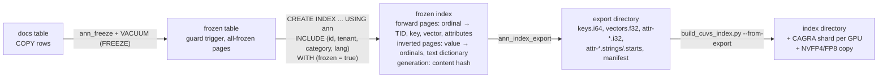
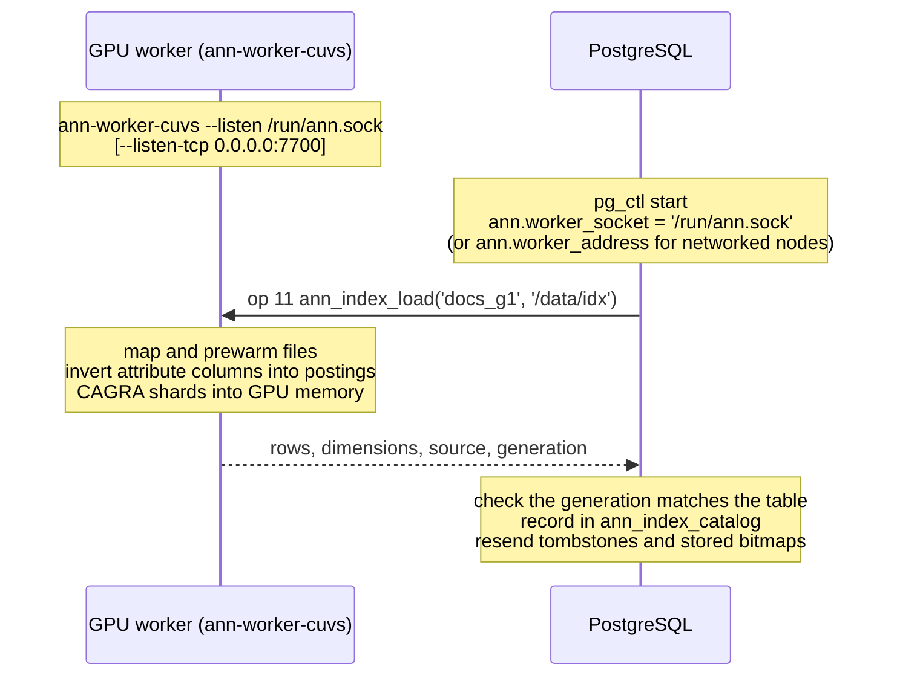

# Frozen ann indexes: forward, inverted and GPU ANN over one numbering

A frozen `ann` index is built once from a table that can no longer change. In one pass it stores three indexes that number rows the same way: ordinal *i* is the row with the *i*-th smallest key.

| Index | What the frozen pages hold | Used by |
| --- | --- | --- |
| Forward (ordinal → row) | heap TID, key, vector, INCLUDE attribute values | the frozen search route, index-only scans, `ann_frozen_keys`, the export |
| Inverted (value → ordinals) | per attribute: distinct values, offsets, postings, bitsets of frequent values, and a dictionary for text | predicate programs evaluated in PostgreSQL, `ann_frozen_filter`, `ann_frozen_keys`, `ann_filter_bitmap_build` |
| ANN | exported to the cuVS builder, which adds CAGRA shards and quantized copies | the GPU worker, through the frozen route and the `ann_*_search` functions |

The GPU worker already numbers rows by key rank (`keys.i64` is sorted), so the export is byte-for-byte what `scripts/ann/build_cuvs_index.py` writes from SQL. A filter evaluated on either side selects the same bits: PostgreSQL (from the pages) and the worker (from its postings) run the same evaluator, `ann/filter.c`. A content hash (the generation) in the index, the exported manifest, the catalog and every request header ties the GPU index to the table.

This implements the [plan](ann-immutable-indexes-plan.md), phases 1 to 4.

## How it fits together

**1. Build** (once per table generation, on the PostgreSQL host):



**2. Start and load:**



**3. A filtered query:**

```sql
SELECT id, tenant, lang FROM docs
WHERE tenant = 7 AND category IN (1, 2) AND lang = 'fr'
ORDER BY emb <-> $1 LIMIT 10;
```

```mermaid
sequenceDiagram
    participant B as PostgreSQL backend
    participant W as GPU worker
    Note over B: planner: WHERE translates → Custom Scan (AnnFrozenSearch)<br/>WHERE → predicate program (cached; 'fr' → dictionary code)<br/>worker for (table, generation) from ann_index_catalog
    B->>W: op 22: program + query vector, generation in the header
    Note over W: generation matches? (else "stale")<br/>program in the predicate cache? else evaluate over postings<br/>→ eligible rows, minus tombstones
    Note over W: route by eligible rows:<br/>≤ 2,000: exact CPU scan<br/>≤ gather limit: GPU gather scan (same-filter queries grouped on tensor cores)<br/>larger: filtered CAGRA · every row: plain CAGRA<br/>FP32 re-score → top k
    W-->>B: ordinals, distances, eligible count
    Note over B: ordinal → TID<br/>every column in the index and page all-visible → row from index pages<br/>else heap fetch · recheck quals · skip tombstones<br/>refill if an approximate route came back short → LIMIT 10
```

Without a worker (none loaded for this generation, or unreachable), the backend evaluates the program over the inverted pages (with the shared filter cache) and scores the eligible rows exactly from the vector pages, then returns rows the same way. Across many hosts, [collections](ann-collections.md) replace the single worker call with one request per replica set and merge the parts' hits.

## Usage

```sql
-- 1. load the data, then make the table immutable
COPY docs FROM '/data/docs.csv' (FORMAT csv);
SELECT ann_freeze('docs');      -- installs the ann_frozen_guard trigger
VACUUM (FREEZE) docs;           -- every page all-frozen in the visibility map

-- 2. build: the first INCLUDE column is the key, the rest are attributes
CREATE INDEX docs_ann ON docs USING ann (embedding vector_l2_ops)
    INCLUDE (id, tenant, category, lang) WITH (frozen = true);

-- 3. GPU index: export the pages, build CAGRA from them, load (the generation is checked)
SELECT ann_index_export('docs_ann', '/data/ann/docs-export');
```

```sh
python3 scripts/ann/build_cuvs_index.py --from-export /data/ann/docs-export \
    --out /data/ann/docs --shards 8 --quantize nvfp4
```

```sql
SELECT ann_index_load('docs', '/data/ann/docs');

-- 4. plain SQL: the planner sends the predicate to the GPU node
SELECT id, tenant, embedding <-> $1 AS distance
FROM docs
WHERE tenant IN (7, 9) AND category BETWEEN 10 AND 19 AND NOT lang = 'de'
ORDER BY embedding <-> $1 LIMIT 10;
--  Limit
--    ->  Custom Scan (AnnFrozenSearch) on docs
--          Search Route: frozen index predicates on GPU worker "docs"
--          Columns: index pages when all-visible
--          Filter Rows: 41873   Heap Fetches: 0
```

The other functions:

```sql
SELECT * FROM ann_frozen_info('docs_ann');            -- generation, rows, attributes, distinct values, pages
SELECT * FROM ann_frozen_keys('docs_ann', 'tenant', ARRAY[7, 9]);       -- keys of rows with tenant 7 or 9
SELECT eligible, bitmap FROM ann_frozen_filter('docs_ann', 'tenant = 7 AND category < 50');  -- from pages
SELECT eligible, bitmap FROM ann_index_filter('docs', 'tenant = 7 AND category < 50');       -- on the GPU node
SELECT ann_filter_bitmap_build('docs', 'category IN (1, 2)');   -- stored filter, evaluated from pages
SELECT ann_frozen_prewarm('docs_ann');                 -- read the index into memory; returns bytes read
SELECT ann_frozen_precompute('docs_ann', ARRAY['tenant = 7', 'category BETWEEN 10 AND 19']);  -- cache frequent filters
SELECT * FROM ann_frozen_cache();                      -- shared filter cache: entries, bytes, hits, misses, evictions
```

## The freeze contract

`CREATE INDEX ... WITH (frozen = true)` checks, in order:

- **A permanent table, plain columns.** No unlogged or temporary tables, no partial or expression indexes.
- **Column types.** The vector column has dimensions. The first INCLUDE column (the key) is `smallint`, `integer` or `bigint`. Attributes (the other INCLUDE columns) are `smallint`, `integer`, `bigint` (values that fit an `integer`), `boolean`, `date` (not `-infinity`), `text` or `varchar`. Every attribute is stored as an int32, the type the GPU worker filters on: integers as themselves, booleans as 0/1, dates as days, and text as codes of a dictionary sorted in the column's collation. An `integer[]` attribute is multi-valued: each row holds any number of int32 values (see [multi-valued attributes](#multi-valued-attributes)). `enum` and other types are refused.
- **The guards.** A `BEFORE INSERT OR UPDATE OR DELETE OR TRUNCATE ... FOR EACH STATEMENT` trigger and a `BEFORE INSERT OR UPDATE OR DELETE ... FOR EACH ROW` trigger, both enabled `ALWAYS`, running `ann_frozen_guard()`. The row guard also rejects writes routed through a partition or inheritance parent; PostgreSQL does not run the child's statement trigger for those writes. The build identifies both by their function and events. `ann_freeze(table)` installs missing guards, including repairing tables frozen by older versions, and returns `false` when both already exist. Dropping `ann_frozen_guard` automatically drops its row guard too. They also stop `COPY`, `MERGE`, writes under `session_replication_role = replica`, and direct statements that match no rows. Load the data before calling `ann_freeze`, since `TRUNCATE` (and so `COPY ... FREEZE` into a truncated table) is blocked too. After upgrading, rerun `ann_freeze` on existing frozen tables to add their row guards. With `ann.frozen_immutable` on, both guards must fire always for a table to count as immutable.
- **All-frozen pages.** Every heap page must be all-frozen in the visibility map, so every indexed row version is visible to every snapshot and no dead or in-progress version takes an ordinal. All-zero pages, which bulk loads (`COPY`, `CREATE TABLE AS`) leave at the end of a table and VACUUM never marks, count as frozen: they hold no rows. VACUUM leaves pages unfrozen while another session holds them, or until asynchronous commits (`synchronous_commit = off`) are flushed; the error says how many pages are missing, and another `VACUUM (FREEZE)` fixes it.
- **Rows.** No NULL keys or vectors, unique keys, fewer than 2^32 rows. NULL attributes are stored as `-2147483648`, which is therefore rejected as a real value. The builder writes NULL attributes the same way.

After the build, `aminsert` refuses every insert ("cannot insert into frozen ann index"), even if the guard is dropped. To change the table, either drop the index and the guard, write, then freeze, vacuum and build again (a new generation, and the old GPU directory no longer loads), or add rows to a delta table next to it (see [new rows](#new-rows-a-frozen-base-and-a-delta)).

**Dump and restore.** `pg_dump` writes indexes before triggers, and restores load rows with plain `COPY`, so restoring a frozen table's `CREATE INDEX` fails: the guard doesn't exist yet and no page is frozen. The guard is restored right after it. Then run `VACUUM (FREEZE)` and the `CREATE INDEX` again; the generation is the same, so existing GPU directories still load. The guard is per table: a partitioned table needs `ann_freeze` and a frozen index on each frozen partition.

**Keeping the vectors smaller.** The vector copy is most of a frozen index (5.2 of 5.5 GB at 10M × 128). `WITH (frozen = true, vectors = half)` keeps FP16 halves of it, and `vectors = heap` keeps none:

| `vectors` | Index (10M × 128, two attributes) | Per row | Build | CPU route, 0.1% / 1% filter |
| --- | --- | --- | --- | --- |
| `float` (default) | 5,496 MB | 576 B | about 30 s | 3.0 / 60 ms |
| `half` | 2,807 MB | 294 B | 16.3 s | 5.3 / 52 ms |
| `heap` | 287 MB | 30 B | 9.9 s | 14.4 / 65 ms |

The GPU routes don't read the vector pages, so they are unchanged. With half or no pages, the CPU routes (the frozen route without a worker, and the access method's ordered scans) score half vectors widened to FP32, or the heap's vectors read by TID. Half distances are rounded, so those routes' order can differ from exact SQL among near ties; the heap's are exact. The vector column is then never served from the index: index-only scans don't offer it, the frozen route fetches it from the heap when a query reads it, and `ann_index_export` writes the heap's exact vectors, so the GPU index is the same file as from a float index (the generation is the same too). `ann_frozen_sizes(index)` lists each structure's pages and bytes and how the vectors are kept. At 30 bytes per row, the forward and inverted index of a billion rows without vectors is about 30 GB.

If the guard is dropped and rows are deleted anyway, VACUUM doesn't move any ordinal: it overwrites the deleted rows' TIDs with an invalid TID, and scans skip them, so heap slots can be reused safely. The GPU index still holds those rows until it is rebuilt; the frozen route skips them, and joins back to the table drop them, as for any loaded index.

## Page layout

Block 0 is the metapage (layout version 5 when an attribute is `integer[]`, else 4, the same bytes as before; versions 2 and 3, without bitset pages and dictionaries or without stored names, still read). Builds without `integer[]` support refuse version 5 as an invalid metapage, so such an index needs a rebuild after a downgrade. After the existing header it holds the row count, the generation, the guard trigger's OID, and a directory of arrays. Every structure is an array of fixed-width elements over consecutive pages. Element *i* of an array is on block `start + i / perPage` at byte `(i % perPage) × width` of the page contents, with 8,160 bytes per page. Each page's `pd_lower` covers its elements, so full-page WAL images keep them.

| Array | Element | Per page | 10M rows, 128 dims |
| --- | --- | --- | --- |
| TIDs | `ItemPointerData` (6 bytes) | 1,360 | 7,353 pages |
| Keys | `int64` | 1,020 | 9,804 pages |
| Attribute values, per column | `int32` (text: its code); `integer[]`: every row's elements in ordinal order, a NULL array as one `-2147483648` | 2,040 | 4,902 pages |
| Row starts, per `integer[]` column | `uint32` index of each row's first element, plus the end | 2,040 | 4,902 pages |
| Vectors | a complete `Vector` (8-byte header + 4 × dims); with `vectors = half`, 2 × dims bytes of FP16; with `vectors = heap`, none | 15 (half: 31) | 666,667 pages (half: 322,581) |
| Postings, per column | `uint32` ordinals, grouped by value, ascending within a value | 2,040 | 4,902 pages |
| Distinct values, per column | `int32`, ascending | 2,040 | 1 page |
| Offsets, per column | `uint32` start of each value's postings, plus the end | 2,040 | 1 page |
| Bitsets, per column | `uint32` words, `(rows + 31) / 32` per value holding at least `bitset_min` rows (default rows / 32), and the values' positions | 2,040 | 154 pages per value |
| Dictionary, per text column | the distinct strings' bytes in collation order, and a `uint32` offset per code | 8,160 bytes | |

Vectors are stored as whole `Vector` values, so the distance function reads them in place. A value lookup is a binary search over the distinct values, two offsets, then one contiguous run of postings; the keys of those ordinals come from the key pages. A range of values is a contiguous run of codes and so of postings. For text, a value's code comes from a binary search of the dictionary with the column's collation, and string ranges are code ranges because the codes follow the collation.

**Build.** `table_index_build_scan` feeds `(key, TID, vector, attributes)` to a tuplesort on the key (`maintenance_work_mem`). The sorted output assigns ordinals: TIDs, keys and attribute values fill pages reserved for them, while vectors are appended after them, all in one pass. Each attribute also feeds a datum sort of `value × 2^32 + ordinal`, which yields its postings in order; distinct values, offsets and bitset pages follow. A text column first goes through a `(string, ordinal)` sort in its collation, which assigns codes, writes the dictionary and fills its value pages. An `integer[]` column writes each row's elements and start, and feeds the sort once per distinct element of the row (a NULL array under `-2147483648`), so its postings are the distinct (value, row) pairs. The build memory beyond the sorts is the distinct values and offsets of one column at a time (plus one int32 per row for a text column). The pages go through shared buffers and are WAL-logged with `log_newpage_range`, like other `ann` builds.

**Reading pages from host memory.** A frozen index's pages never change after its build, apart from the TIDs VACUUM can invalidate, so backends read them through read-only mappings of the index files rather than shared buffers. Every backend maps the same files, the operating system keeps one copy in memory (the host's memory, not `shared_buffers`, bounds what stays resident), and reads take no buffer pins or content locks. TIDs use shared buffers except for the bounded unchanged-TID batches described below. The build flushes the index's buffers and marks its metapage (`insertPage = 0xFFFFFFFD` for unchanged TIDs, `0xFFFFFFFE` after invalidation or in older flushed builds); only flushed indexes are mapped, so earlier unmarked indexes use buffers until a `REINDEX` (which keeps the generation). Before a backend maps an index it flushes the index's buffers again (pages replayed after a crash or a promotion may not have reached the files yet), each mapped array is checked on open (its first and last pages must be finished `ann` pages), a mapping is checked against the relation's size once per relcache entry, and nothing is mapped during recovery or on a hot standby, where replay writes go to shared buffers first. `ann.frozen_mmap = off` reads everything through shared buffers. A backend asks the kernel to read a file ahead (`MADV_WILLNEED`) when it first maps it, and `ann_frozen_prewarm(index)` reads every page ahead of queries: the mapped arrays into the page cache, the TID pages into shared buffers. On the GPU node, the worker keeps its copies resident already: the CAGRA graph, the NVFP4 rows and every cached predicate's bitsets and rows live in GPU memory, and its attribute postings in host memory. `ann.frozen_immutable = on` (superuser, default off) is for tables that take no UPDATE, DELETE or VACUUM after the build, such as a served segment: TID pages are mapped too, and covering scans skip the visibility map, so a search takes no buffer pins or content locks at all. It applies to a table only while the guard trigger of its build is enabled always (an origin trigger doesn't fire in sessions in replica mode or in logical replication workers) and only while the table is unchanged since the build: every page is still all-visible, and VACUUM has never invalidated a TID of the index (the metapage is still `0xFFFFFFFD`). With the guard disabled or dropped, or with pages a write touched not yet all-visible again, scans and `ann_frozen_prewarm` treat the table as mutable. A VACUUM that removes rows from a frozen index invalidates their TIDs whatever the setting and clears that mark, so the table stays mutable for it after the guard is enabled again (a rebuild makes it immutable again). While it is on, `ann_frozen_delete` fails.

**Attribute names.** The metapage keeps each attribute's name as of the build. Predicate programs and exports use those names, while SQL resolves columns by position, so renaming (even swapping) columns after the build can't make a program read another column.

**Generation.** `hash_bytes_extended` chained over every key, vector and attribute value (text: its bytes; `integer[]`: its elements, then their count or NULL) in ordinal order, plus the dimensions, column count and row count. Indexes without `integer[]` attributes hash exactly as before. The same rows in another table, inserted in another order, get the same generation. `REINDEX` keeps it, and any changed value changes it.

## Predicates

The planner, `ann_frozen_filter`, `ann_index_filter` and `ann_filter_bitmap_build` turn a predicate over the attribute columns into a predicate program ([ann/filter.h](../ann/filter.h)): a postfix list of leaves and operators.

| SQL | Program |
| --- | --- |
| `a = v`, `a IN (...)`, `a = ANY(array)` | `VALUES a v...` |
| `a <> v`, `a NOT IN (...)`, `a <> ALL(array)` | negated `VALUES` (rows whose `a` is NULL never match, as in SQL) |
| `a < v`, `<=`, `>`, `>=`, `BETWEEN` | `RANGE a low high` |
| `a IS [NOT] NULL` | `NULL a`, negated |
| `flag`, `NOT flag`, `flag IS [NOT] TRUE/FALSE/UNKNOWN` | `VALUES flag 1`, `VALUES flag 0`, with `NULL flag` where SQL includes NULLs |
| `AND`, `OR`, `NOT` | `AND`, `OR`; `NOT` is pushed down to the leaves |
| `m && array`, `array && m` (`integer[]` attribute `m`) | `OVERLAP m v...`: the array's distinct elements, without NULLs |
| `NOT (m && array)` | negated `OVERLAP` (rows whose `m` is NULL never match) |
| constants out of range, `= NULL`, `IN ()` | `NONE`; `<> ALL('{}')` is `ALL` |

Predicates the evaluator would refuse (more than 1,024 instructions, AND/OR nested deeper than 62, or more than 1 MB of constant values) keep ordinary plans; a parameter list that makes the program too large is an error at execution. Operands are constants, parameters (including generic plans) or stable expressions without columns; integer operands of any width compare with integer attributes, `date` with `date`, `boolean` with `boolean`, `text` with `text`/`varchar` in the column's collation. A predicate that uses any other column, operator, function of a column, collation or volatile function isn't translated: the planner keeps its ordinary plans, and `ann_filter_bitmap_build` runs the filter as SQL, as before.

### Multi-valued attributes

An `integer[]` INCLUDE column holds a set of int32 values per row, such as the codes of a document's tags or of the groups an item belongs to. `m && array` (the built-in `anyarray && anyarray`, written `OPERATOR(pg_catalog.&&)` where another extension may define its own `&&`) becomes one `OVERLAP` leaf, evaluated as the union of the values' postings, like `IN` on a single-valued attribute. The other side is an `integer[]` constant, parameter or stable expression: its NULL elements are dropped (they never overlap) and its values sorted and deduplicated. An empty array matches no row, and its negation every row whose array isn't NULL; a NULL array operand matches none. `m IS [NOT] NULL` is the `NULL` leaf. Other array operators (`=`, `@>`, `<@`, `= ANY(m)`, subscripts, functions of `m`) aren't translated. A constant array of more than 65,536 elements keeps the ordinary plan; a parameter that has more makes the frozen route fail at execution, as an `IN` list does.

The arrays must be empty or one-dimensional with lower bound 1 (index-only rows rebuild them that way), without NULL elements or `-2147483648`, and an index holds fewer than 2^32 elements per column; the build refuses anything else. Index-only scans and rows from the pages return each array as stored, with its order and repeats; `'{}'` and NULL stay distinct. `ann_frozen_keys(index, column, values)` returns each row holding any of the values once, `ann_frozen_info` counts the distinct elements (and NULL), and `ann_frozen_sizes` lists the row starts. Programs carry the attribute kind: an `OVERLAP` leaf on a single-valued attribute, or `VALUES`/`RANGE` on a multi-valued one, fails with `predicate applies an operator to an attribute of another kind` (on the worker, an invalid program).

The evaluator keeps each intermediate set as a sorted list while it holds fewer than rows / 64 ordinals, and as a bitset otherwise. Lists intersect and merge in one pass; bitsets combine word by word; a prebuilt bitset replaces a frequent value's postings.

The clauses of a top-level AND are put in an order of their own (by their instructions' bytes), so `tenant = 7 AND category = 3` and `category = 3 AND tenant = 7` are one program, whichever order the query wrote or the planner chose, and share one cache entry on every host.

**Shared filter cache.** Within a generation a program always selects the same rows, so PostgreSQL evaluates each one once per cluster. The rows of every program evaluated from the pages (the route without a worker, the exact completion of a short worker answer, `ann_frozen_filter`, `ann_filter_bitmap_build`) go into a cache in dynamic shared memory that every backend reads: a bitmap over the index's rows (1.25 MB at 10M rows) and its row count, keyed by the index, its generation and the program (a hash, then the bytes compared). A rebuilt index has a new generation, so it never sees an older one's rows. A hit copies the bitmap out, so a result is kept only when evaluating it took at least one nanosecond of the backend's CPU time per two bitmap bytes (625 µs at 10M rows, about four copies), or its bitmap is at most 64 kB: a `category BETWEEN` range taking 9 ms is kept, a `tenant = t AND category = c` intersection taking a fraction of a millisecond usually is not (in the run below, 2,693 of about 1.5 million), and doesn't displace one that is. Bytes are reserved before an entry is allocated, so concurrent backends stay within the bound while one of them evicts. A result under 1/64 of the rows is kept as its ordinals (4 bytes each) and its bitmap rebuilt on a hit. `ann.frozen_filter_cache_mb` (default 4096, superuser) bounds the cache; past it, the least recently used entries go first, down to 90% of the bound, and `0` turns it off. The segment is found through PostgreSQL's DSM registry, so it needs PostgreSQL 17 or later but no `shared_preload_libraries`; older servers evaluate every time. `ann_frozen_cache()` reports entries, bytes, hits, misses and evictions.

**Precomputing frequent filters.** `ann_frozen_precompute(index, filters)` translates each filter (SQL over the INCLUDE attributes, as in `ann_frozen_filter`), evaluates it into the shared cache, and, when a GPU worker serves the index's generation, sends it to every worker (operation 23) so it's cached there too. Precomputed filters are cached however cheap they were to evaluate. The first queries using them then find their rows ready instead of waiting for an evaluation. It returns how many filters it cached, and warns about a worker that couldn't cache one.

## The frozen search route

`ann.enable_frozen_search` (default on) adds a path for every query over a table with a valid frozen index whose first `ORDER BY` key is the distance from its vector column to a constant or parameter, when every restriction on the table translates to a program. The path sits at the scan level and carries the distance ordering, so it also serves partitions and `UNION ALL` branches under PostgreSQL's MergeAppend (see [new rows](#new-rows-a-frozen-base-and-a-delta)). EXPLAIN shows it as `Custom Scan (AnnFrozenSearch)`.

The path is costed, and the planner chooses between it and ordinary plans (a btree or sequential scan and a sort, an `ann` index scan). Before the first row it charges `ann.frozen_setup_cost` (default 1000, a call to the worker or an evaluation from the pages) plus `cpu_operator_cost` for each row the predicate selects, by PostgreSQL's estimate. Each row returned then costs `cpu_tuple_cost`, the qual recheck, and `cpu_index_tuple_cost` when the index covers the query or `random_page_cost` when it fetches from the heap. A LIMIT charges only the rows it takes. So a large table, or a filter selecting many rows, takes the route, while a filter a btree narrows to a few hundred rows is sorted locally instead. Lower `ann.frozen_setup_cost` to favour the route, raise it to favour local plans; the cost doesn't yet depend on whether a worker has the generation loaded.

At execution:

1. The scan finds the loaded export of its index's generation: `ann_index_catalog` rows whose `source` is the table and whose `generation` matches, the most recently loaded one. The name is cached per backend, and read again after a failed call (and, when none was loaded, at most once a second).
2. It builds the program, evaluates the query vector and sends both in operation 22, with the generation in the request header and `ANN_PREDICATE_ORDINALS`. The worker evaluates the program (or finds it cached), searches the rows it selects on its usual route (exact, GPU gather, grouped tensor-core scan, filtered CAGRA; plain ANN for a program matching every row), and returns ordinals and distances.
3. Each ordinal's TID comes from the TID pages. When every column the query reads is in the index (the vector, the key, the attributes) and the heap page is all-visible, the row is built from the index pages (`Heap Fetches: 0`); otherwise it's fetched from the heap with the query's snapshot. The table's quals are rechecked on each row, except on rows built from the pages of an immutable table (`ann.frozen_immutable` applying): every qual is in the program, which selects exactly SQL's rows, so the scan drops the recheck and reads only the columns the target list needs. `ann.frozen_recheck = on` keeps it there too; EXPLAIN shows `Qual Recheck` and, for an immutable table, `Columns: index pages`.
4. The first request asks for `LIMIT + OFFSET` rows (100 without a limit). In a generic plan, where the planner can't estimate `LIMIT $1`, the scan evaluates the parameter `LIMIT` and `OFFSET` at execution instead, when nothing (grouping, aggregates, DISTINCT, window or set-returning functions) sits between the scan and the `LIMIT`; requests stay within 10,000 rows. If the consumer wants more, the scan asks again for four times as many and skips the rows it already returned. The worker also reports how many rows the program selected; if it returns fewer than asked while more qualify (filtered CAGRA is approximate), the remaining rows come from the pages, exactly. Rows from a refill of an approximate route can come out of distance order with the ones already returned, as with any approximate index; the exact, gather and page routes keep the order.

Without a worker for the generation (none loaded, the nodes unreachable, or a worker without operation 22), the scan evaluates the program from the pages and scores the selected rows on the CPU from the vector pages: exact, the complete ordering at once. EXPLAIN ANALYZE reports `Filter Rows` (the program's rows), `Heap Fetches`, `Worker Calls`, the worker's `Worker Route` (graph, filtered graph or exact scan) and whether its reply was short of the rows asked (`Worker Reply Short`, which makes the scan finish from the pages), and `Local Evaluations`.

Distance-ordered results can jump between many visibility-map pages. Each scan retains up to 32 visibility-map buffer pins to avoid repeated buffer lookup and pin/unpin work. It still reads the current visibility bit for every tuple; neither visibility decisions nor mutable TIDs are cached. Pins are released when the scan ends, and heap fetches still use the query's snapshot whenever the page is not all-visible.

`ann.frozen_prefetch_distance` (default 4, per session, range 0–64) issues CPU-cache hints for immutable mapped vectors, keys and attributes a few result rows ahead. It preserves distance order and the usual row materialization; mutable TIDs and visibility-map bits still use their normal access paths. `0` disables the hints, and readers without mmap use the buffered fallback. On the GPU worker, `--rerank-prefetch` (default 8, range 0–64) separately controls lookahead over host FP32 vectors before reranking. It changes neither scoring arithmetic nor GPU candidate selection; `0` disables it.

Hot predicate-cache hits also have a backend-local path: the first shared hit copies an immutable result into a bounded private cache; subsequent hits compare the program and copy the result without shared-cache locks, with one atomic hit-counter update. `ann.frozen_filter_local_cache_mb` defaults to 16 MB per backend (never more than the shared-cache budget), and `0` disables it. The cache has 256 direct-mapped slots, keeps sparse results as ordinals, and compares program bytes as well as hashes. Shared eviction cannot reclaim a private copy, and the key includes the database, index and generation. Cold shared-cache lookups, insertions and eviction still synchronize. Immutable page reads through mmap likewise avoid page locks; TIDs, heap visibility, relation locks and worker scheduling retain their normal synchronization. This does not make the entire SQL or worker execution lock-free. Sampled relations (`TABLESAMPLE`) use PostgreSQL's ordinary sample scan.

## Worker operations and caching

| Operation | Payload | Reply |
| --- | --- | --- |
| 22 search by predicate | u32 name length, name, u32 dimensions, k, flags (1: ordinals; 2: append each hit's attribute values: u32 attributes, then i32 per hit and attribute in the index's order, NULL as INT32_MIN), program length, program; FP32 query | u32 count, u32 route, u64 eligible rows, then (i64 key or ordinal, f32 distance) per hit |
| 23 evaluate predicate | u32 name length, name, program | u64 eligible rows, then the bitmap as u32 words |

The worker evaluates a program over its attribute postings (`attr-*.i32`, inverted at load) and caches the rows under the program's hash, as a bitmap entry like a pushed one (operation 20): per-shard bitsets, rows for the exact and gather routes, and device copies. Repeated predicates then cost a hash lookup, and searches over the same predicate group into one scan like any cached filter. A program being evaluated by one connection makes others wait for it rather than evaluate it again. Device copies are allocated and freed stream-ordered on a stream per device, so a new predicate doesn't stall the searches running there. Each result costs a bitmap over the index's rows (1.25 MB at 10M rows), its rows when a gather scan may read them, and device copies of what its routes read: bitsets only when filtered CAGRA may run it, rows only past the exact limit (smaller filters run exact on the CPU).

A sparse result, under 1/64 of the rows and within the gather limits, keeps only its rows: the scans read nothing else, and the evaluate reply (operation 23) rebuilds the bitmap from them. On the 10M-row index with 100,000 distinct, mostly empty `tenant AND category` predicates, the cache held 101,000 entries in 320 MB (3.2 KB each) instead of 125 GB, and the workload ran at 88.5k QPS against 69.7k on one B200.

Predicate results are bounded by memory, not by count. Per index, `--predicate-cache-mb MB` (default a quarter of the host's RAM) bounds their host memory and `--predicate-device-mb MB` (default 8,192) their GPU memory. Past either, the least recently used results go first, down to 90% of the bound; a result that alone exceeds a bound isn't kept. `--predicate-cache N` additionally caps the count (default 0, no cap). A 2 TB host keeps about 400,000 predicates over a 10M-row index this way, against the earlier fixed 1,024.

At load, the worker reads every mapped index file into memory (`--prewarm on`, the default) so the first searches and evaluations don't wait on the disk, and logs the size and time. `--lock-memory on` also `mlock`s what searches and filters read: keys, vectors, quantized rows and scales, and attribute postings. A refusal (`RLIMIT_MEMLOCK`) is reported once, and the worker runs unlocked.

The stats reply (operation 8) adds `predicate_hits`, `predicate_evaluations`, `predicate_eval_us`, `predicate_entries`, `predicate_bytes`, `predicate_device_bytes` and `predicate_evictions`; operation 15 adds `predicates on`.

## Export

`ann_index_export(index, directory)` writes `manifest` (with `shards 0` and `generation G`), `keys.i64`, `vectors.f32` without the `Vector` headers, and one `attr-COLUMN.i32` per attribute: integers as themselves, booleans as 0/1, dates as days, text as its dictionary codes (so `ann_attribute_search` on a text attribute takes codes; the frozen route translates strings itself), with the dictionary in `attr-COLUMN.strings` (the strings' bytes in code order) and `attr-COLUMN.starts` (u32 offsets) and a `dictionary COLUMN STRINGS STARTS` manifest line, which [collections](ann-collections.md#text-attributes) map to their own codes. For an `integer[]` attribute, `attr-COLUMN.i32` holds every row's elements in key order (a NULL array as one `-2147483648`), `attr-COLUMN.offsets` (u32, rows + 1) where each row's elements start, and the manifest has `multivalued COLUMN attr-COLUMN.offsets` on the line after the attribute's; a worker without multi-valued support refuses the line, so load such directories on a new worker. Names that a manifest can't hold (spaces, slashes, more than 63 bytes) are refused. The directory must be absolute and new or empty, and the manifest is written last with `durable_rename`. It needs superuser or `pg_write_server_files`, plus `SELECT` on the table. `build_cuvs_index.py --from-export` hard-links the files into the index directory (copying across file systems), keeps the export's `source`, `key`, `vector`, `attribute`, `dictionary`, `multivalued` and `generation` lines, and adds shards, `dtype` and `quant`; one export can feed several builds. Several exports combined into one index (repeated `--from-export`) must have the same multi-valued attributes; their elements are concatenated and their row offsets rebased. The `--attribute` path from a table refuses array columns.

`ann_frozen_info`, `ann_frozen_keys`, `ann_frozen_filter` and `ann_index_filter` need `SELECT` on the table and refuse tables with row-level security, since they return rows without applying policies.

## Generations on the GPU nodes

- **Catalog.** `ann_index_load` and `ann_index_attach` require a valid frozen index on the manifest's `source` table with the manifest's generation (directories built from SQL have none and load as before), and record the generation in `ann_index_catalog.generation` (added by the 0.9.1 upgrade).
- **Requests.** PostgreSQL puts the generation of the index it means in the request header's generation field: the frozen route uses its index's, and the `ann_*_search` functions the catalog's (cached per backend). A worker serving another generation of that name answers status 12 (`ANN_GENERATION`); the functions read the catalog again and retry once, and the route falls back to the pages.
- **Stored filters.** A filter's id hashes its index name, its text and, for exported frozen indexes, the generation. A rebuilt table's filters get new ids, so the GPU nodes never answer with a bitmap over another generation's ordinals: `ann_index_load` pushes only the stored rows of the current generation, and `ann_bitmap_search` refuses a stored row built for another one (rebuild it with `ann_filter_bitmap_build`).

## New rows: a frozen base and a delta

A frozen table can't take new rows, but a table next to it can. Make both partitions of one table (or branches of a `UNION ALL` view): the frozen base with its frozen index, and a delta that takes inserts, with an ordinary index or none.

```sql
CREATE TABLE docs (id bigint, tenant int, category int, embedding vector(128)) PARTITION BY RANGE (id);
CREATE TABLE docs_delta PARTITION OF docs DEFAULT;
ALTER TABLE docs ATTACH PARTITION docs_base FOR VALUES FROM (0) TO (10000001);   -- frozen, indexed
INSERT INTO docs ...;   -- new keys land in docs_delta

SELECT id FROM docs WHERE tenant = 7 ORDER BY embedding <-> $1 LIMIT 10;
--  Limit
--    ->  Merge Append
--          Sort Key: ((docs.embedding <-> $1))
--          ->  Custom Scan (AnnFrozenSearch) on docs_base   (GPU worker, generation G1)
--          ->  Sort -> Seq Scan on docs_delta                (exact)
```

PostgreSQL merges the two ordered inputs under one `LIMIT`, with its own MVCC for the delta, so the answer equals exact SQL over the whole table whenever the base's route is exact (the CPU route, and the worker's exact and gather routes; filtered CAGRA is approximate, as everywhere).

**Publishing a new generation** folds the delta in without a gap:

1. Build the next base: `CREATE TABLE docs_base2 AS SELECT * FROM docs` (base and delta), then `ann_freeze`, `VACUUM (FREEZE)`, `CREATE INDEX ... WITH (frozen = true)`: generation G2.
2. Export, build and `ann_index_load('docs_g2', ...)`. The catalog now has a row for G2. Queries keep using G1, because the route looks up the worker by the generation of the table it scans.
3. In one transaction, detach `docs_base` and the delta, attach `docs_base2` and a new empty delta (or delete the moved rows from the old delta). Queries planned after it scan G2 with the G2 worker; no request can reach a bitmap of the other generation, since ids and headers carry it.
4. Drop the old base table (its index and guard trigger go with it) and free the old export on the worker: `SELECT ann_index_unload('docs_g1')` unloads it from this host's worker (`ann.worker_address`, else `ann.worker_socket`) once its running searches finish, and removes its `ann_index_catalog` row.

## Deleting rows

A frozen table refuses `DELETE`, but `ann_frozen_delete(table, keys)` removes rows from searches without touching it:

```sql
SELECT ann_frozen_delete('docs_base', ARRAY[42, 1043]);   -- returns how many keys were new
```

The keys go into `ann_frozen_tombstone`; after SQL commit they are sent to every loaded export of the table (operation 29; `ann_index_load` and `ann_index_attach` synchronize exports after their transaction commits). Transaction and savepoint rollback discard pending notifications. Before commit, the deleting session's frozen route excludes its own tombstones locally; worker-only functions see them after commit. Transactions with pending worker notifications cannot use `PREPARE TRANSACTION`. If delivery fails after commit, SQL tombstones remain durable and a warning requests reloading or attaching the export to synchronize it; the worker can remain stale until that succeeds. The frozen route leaves tombstones out on both paths: the worker drops them from predicate results and hits, and the pages route skips their ordinals (each backend rereads the table's tombstones at most once a second, at once after its own delete or rollback; for an immutable table, once per generation). Each active scan owns a copy, so another scan's cache refresh cannot reclaim it. `ann_frozen_delete` fails while `ann.frozen_immutable` is on. Other scans of the table, such as sequential scans or the access method's ordered index scans, still return them: query through the frozen route, or use a `UNION ALL` view that filters them out. To remove them for good, rebuild the table without them (as when [publishing a new generation](#new-rows-a-frozen-base-and-a-delta)) and delete their tombstones.

## Measurements

For larger result sets, see the [k=500 stress test](ann-k500-stress.md): a RAM-backed
10M × 128 dataset on eight B200s, filtered CAGRA and GPU gather routes,
concurrency/mmap controls, and PostgreSQL versus native-worker profiles.

Each PostgreSQL host (clusters A and B: 64 cores, 32 GB shared buffers) ran pgbench with 512 clients. The worker ran on GPU 0 (28 cores, 28 lanes) or all eight GPUs with replication (96 cores, 96 lanes), with `--itopk 64 --max-pending-mb 8192 --predicate-cache 4096`. The data is the 10M × 128 benchmark table (`tenant`: 1,000 values, 0.1% each; `category`: 100 values, 1% each), copied into a permanent table, frozen, and indexed with `INCLUDE (id, tenant, category)`. The export was built into one NVFP4 CAGRA shard. Query vectors come from a 1,000-row table. Every query is plain SQL: `SELECT id FROM f10m WHERE <predicate> ORDER BY emb <-> $1 LIMIT 10`.

**Build and evaluation**

| Step | Time |
| --- | --- |
| `ALTER EXTENSION vector UPDATE TO '0.9.1'` on the 0.9.0 benchmark databases | immediate |
| `CREATE INDEX ... WITH (frozen = true)`, 10M rows, 2 attributes (two hosts, independently) | 29.3 s and 32.5 s; 5.5 GB; the same generation on both |
| `ann_frozen_filter`: `tenant = 7` / `category = 7` / `category BETWEEN 10 AND 19` / `tenant BETWEEN 100 AND 199 AND category < 50` / `NOT (category < 50) OR tenant IN (1, 2, 3)` | 1.8 ms / 0.8 ms / 13 ms / 22 ms / 6.8 ms (10k / 100k / 1M / 500k / 5M rows) |
| `ann_index_export` | 7.7 s |
| `build_cuvs_index.py --from-export --shards 1 --quantize nvfp4` | 31 s |
| A new predicate on the worker: evaluation, caching and device upload | 18 ms on average (1,136 predicates) |

**Throughput: one B200, one PostgreSQL host**

| Workload | Frozen route (plain SQL), pages through mappings | The same through shared buffers | Function on the same index |
| --- | --- | --- | --- |
| 0.1%: `tenant = t` (1,000 distinct predicates) | 121k QPS, p99 5.6 ms | 113k | `ann_attribute_search` 117k; `ann_bitmap_search` 146k |
| 1%: `category = c` | 159k, p99 5.6 ms | 146k | `ann_attribute_search` 154k |
| 10%: `category BETWEEN 10d AND 10d + 9` | 81k, p99 11.5 ms | 81k | `ann_attribute_search` with 10 values: 543 (it merges 1M ordinals per query) |
| 10%, three hot ranges | | 77k | |
| 5%: `tenant BETWEEN ... AND category < 50` | 135k | 133k | no function expresses it |
| no filter | 176k | 164k | `ann_index_search` 188k |

**Throughput: two PostgreSQL hosts** (totals of both hosts, 512 clients each; one B200, then eight with the index replicated)

| Workload | 1 GPU, frozen route | 1 GPU, function | 8 GPUs, frozen route | 8 GPUs, function |
| --- | --- | --- | --- | --- |
| 0.1% | 211k / 196k (two runs) | `ann_bitmap_search` 203k / 197k; `ann_attribute_search` 166k / 162k | 201k | `ann_bitmap_search` 202k; `ann_attribute_search` 208k |
| 1% | 275k / 276k | `ann_attribute_search` 278k | 219k | 221k |
| 10% | 91k / 90k | | 220k | |
| 5% AND | 153k / 153k | | 224k | |
| no filter | 288k / 293k | `ann_index_search` 337k | 243k | `ann_index_search` 287k |

On one GPU, 10% filters are GPU-bound at about 90k QPS; on eight they rise to 220k. On eight GPUs every workload lands between 200k and 243k: the two PostgreSQL hosts (64 cores each, shared with their pgbench clients) are the limit there, not the GPUs or the worker.

**Memory caches** (one B200, host A, 512 clients). `frozen-combo` is `tenant = t AND category = c` with 100,000 distinct predicates, `frozen-combo10k` the same with `t` among 100 tenants (10,000 distinct). In this table `tenant` and `category` are correlated (7,000 pairs occur), so most of these predicates select no rows: the workloads measure predicate turnover, not search.

| Workload | Worker cache of 1,024 predicates (the earlier cap) | Worker cache bounded by memory (defaults) |
| --- | --- | --- |
| `frozen-combo` | 14.8k QPS, p99 110 ms | 69.7k, p99 19 ms |
| `frozen-combo10k` | 16.1k, p99 100 ms | 79.9k, p99 8.3 ms |
| 10% | 79.4k | 79.7k |
| no filter | 166k | 169k |

With 1,024 entries, 10,000 or 100,000 distinct predicates kept evicting each other: 541k evaluations in the run, 1,477 s of evaluation time on the worker. Bounded by memory, the worker evaluated each predicate once (100,030 evaluations) and held 100,010 of them in 125 GB of host memory and 52 MB of device memory, with no evictions. At load it prewarmed the 5.8 GB index in 0.01 s (already in the page cache).

In PostgreSQL (`ann_frozen_filter`, 10M rows), a shared-cache hit takes 0.46–0.49 ms, against 17.6 ms to evaluate `tenant BETWEEN 100 AND 199 AND category < 50` and 9.2 ms for `category BETWEEN 10 AND 19`. Cheap predicates are rarely cached: the route without a worker served `frozen-combo10k` at 57.0k QPS and `frozen-combo` at 51.9k with the cache, and 57.3k and 51.9k with `ann.frozen_filter_cache_mb = 0`. Without the cost rule, those workloads filled the cache with cheap entries (25,000 evictions in one run); without byte reservation, concurrent backends overshot a 4 GB bound to 38 GB. Both were fixed before these runs.

**Profile.**

- **PostgreSQL.** gdb samples of backends running the route (perf is blocked on this host) spent 42 of 48 samples at 0.1%, and 25 of 48 unfiltered, in `poll` inside `AnnRemoteCall`, waiting for the worker. Almost all the rest was the client protocol; building the program and the worker-name lookup (cached) didn't appear. Reading rows from the mapped pages instead of shared buffers raised one host's throughput by 7 to 9% (table above). The route now matches or beats the functions at 0.1% and 1%; unfiltered it is 7% below `ann_index_search`, the cost of the executor nodes above the scan.
- **GPU.** nsys traces of the worker show the same kernels per search as the attribute route (`search_nvfp4` 17.1 µs against 16.4 µs).
- **Fixed during the measurements:**
  - *Evaluation stampede.* A first run reached 1,947 QPS at 0.1%: 512 clients missing the same new predicate evaluated it concurrently, 20,680 evaluations at 478 ms each. Most of that was synchronous `cudaMalloc` and `cudaMemcpy` of device copies, which wait for every search on the device. Single-flight evaluation and stream-ordered uploads bring each distinct predicate to one evaluation of about 18 ms.
  - *Catalog scans.* A build that looked up the attributes' operator families with `GetDefaultOpClass` (a `pg_opclass` scan) on every execution dropped the route to 56k QPS. Frozen metadata and predicate columns are now cached in the index's relcache entry.
  - *Key searches in replies.* The worker converted every hit's key back to its ordinal with a binary search over the 80 MB key array, on the lane thread. Hits now carry their ordinals.
  - *A global lock for a counter.* A per-request statistics counter took the scheduler's mutex; it is an atomic now.
  - *Colliding filter entries.* Two hosts got only 98–132k QPS at 0.1%, and 10% filters sometimes collapsed to 49k, with worker lanes blocked on the scheduler's mutex (gdb samples of the worker). The scheduler groups same-filter searches in a hash table keyed by the addresses of each filter's row arrays, and its hash kept only the pointers' low bits. Predicates first evaluated under load get their arrays from allocator chunks whose low bits barely differ, so hundreds of filters shared a few buckets, and every enqueue walked long chains under the mutex. Predicates evaluated while the worker was idle didn't collide, which is why runs varied. Driving the worker directly, operation 22 went from 79–92k requests/s to 240k (operation 21: 242k). The table now hashes every pointer bit and frees idle entries.
  - *Predicate cache races.* A predicate's result is now returned already referenced when it's cached, so an eviction can't remove it before the search uses it. The eviction ring holds each id once, and predicate results and pushed bitmaps are separate kinds of entry, so operation 20 can't replace or plant a predicate's rows.

**Correctness at scale.** The two hosts built the same generation independently. Filtered results through the route equal exact SQL on the gather routes, and ANN recall@10 through the loaded export was 1.0. Crash recovery was checked by building an index, stopping the cluster with `pg_ctl -m immediate` before a checkpoint, and comparing a 20,000-row ordered scan, a postings lookup and the generation after WAL replay: identical to before the crash and to plain SQL.

## Tests

`test/ann/test_frozen.py` (`ANN_PG_DSN`, superuser) covers:

- **Contract.** Every refusal (INCLUDE without `frozen`, no key, no guard, unfrozen pages, column types, partial index, duplicate and NULL keys, NULL vectors, out-of-range values, unlogged tables). The guard stops INSERT, UPDATE, DELETE, TRUNCATE and COPY, including in replica mode.
- **Scans.** The access method's ordered scans equal sequential exact SQL, as index-only scans with `Heap Fetches: 0`, or as index scans when a column isn't in the index.
- **Predicates.** Twenty predicate shapes (equality, `<>`, IN and NOT IN with NULLs and empty arrays, ranges, BETWEEN, AND/OR/NOT, bigint constants out of range, TRUE/FALSE) select exactly SQL's rows from the pages, with and without bitset pages. Booleans (including IS [NOT] TRUE/UNKNOWN), dates, bigint, text and varchar (ranges under the column's collation, values missing from the dictionary) do too, and another collation isn't translated.
- **Multi-valued attributes.** An `integer[]` attribute (NULL, `'{}'`, repeats, random sets) under `&&` with constants, a generic-plan parameter, `NOT`, empty and NULL operands, NULL elements, `IS [NOT] NULL` and mixed with a single-valued attribute selects SQL's rows from the pages, with and without bitset pages, through the route (with and without the recheck) and through the CPU worker (bitmaps word for word). Rows from the pages and index-only scans return the heap's arrays. A 70,000-value array and other array operators keep ordinary plans. The build refuses NULL elements, two dimensions, other lower bounds and `-2147483648`; indexes without arrays keep version 4 and their structures, arrays give version 5, and the generation ignores row order and follows every element. The export's elements and offsets, `--from-export` linking and two combined members match the table; `--attribute` refuses arrays.
- **The route.** Every shape through the frozen route equals SQL with the route off, rows from pages without heap fetches, columns outside the index from the heap, a generic plan with a parameter `LIMIT`, and unsupported predicates keeping ordinary plans.
- **Immutable tables.** `ann_frozen_delete` fails under `ann.frozen_immutable` and VACUUM of the guarded table succeeds; a disabled guard, an origin guard, or rows deleted under a disabled guard (even after it is enabled again, before and after the VACUUM that removes them) make the scan read TIDs, check visibility (rows deleted meanwhile come from the heap) and recheck quals. Without the recheck every predicate shape equals SQL, as it does with `ann.frozen_recheck = on`.
- **Generic plans.** `LIMIT $n OFFSET $m` in a generic plan asks the CPU worker once (`Worker Calls: 1`) and equals the literal `LIMIT`; `LIMIT NULL` returns every row.
- **Base and delta.** A partitioned table with a frozen base and a delta (inserts land in the delta; the base refuses them) answers through Merge Append over the route, equal to SQL.
- **The worker.** With the CPU worker: the worker's bitmaps (operation 23) equal the pages', word for word, for every shape. Routed queries go to the worker and equal SQL. `ann_filter_bitmap_build` builds from the pages and `ann_bitmap_search` equals SQL.
- **Generations.** A catalog naming another generation makes the worker refuse tagged requests (status 12, an error from the functions after a retry) and sends the route to the pages. A new base generation, loaded under a new name, is found by the route. Dropping the old base removes its guard.
- **Renames, rescans and limits.** Swapping two attribute columns' names after the build leaves results equal to SQL; a lateral join rescans the route once per outer row; a predicate too large for a program keeps an ordinary plan; `ann_index_filter` refuses a role without `SELECT`.
- **Postings, generation stability, VACUUM after a dropped guard, export byte identity, and loading**, as before. The worker-route tests above use the CPU worker; operation 22 on the cuVS worker was checked by the benchmarks' exactness runs, not by a test; **cuVS** (`FrozenCuvsTests`, `ANN_CUVS_TEST=1`): an export built into 2 CAGRA shards plus an NVFP4 copy serves filtered searches equal to SQL and ANN recall of at least 0.9.

```sh
ANN_PG_DSN='host=/tmp dbname=postgres' python3 test/ann/test_frozen.py
ANN_CUVS_TEST=1 ANN_PG_DSN='host=/tmp dbname=postgres' python3 test/ann/test_frozen.py FrozenCuvsTests
```

`make -C ann check`, `check-postgres` and `check-cuvs` include them.

### Batched TID visibility checks

`ann.frozen_materialize_batch` controls bounded visibility windows for covering
`AnnFrozenSearch` results (default 64; 0 disables, up to 1024 rows). New
frozen builds mark TIDs as unchanged. While this marker holds, a window reads mapped TIDs and
checks their heap visibility bits under one shared metapage lock. This avoids
a separate shared-buffer lookup and TID-page lock for every returned row.
`EXPLAIN ANALYZE` reports `Mapped TID Rows` for these validated proofs; the
counter can exceed emitted rows because a window validates rows ahead.
The SQL matrix function uses the same checks for each vector's result list.

VACUUM takes an exclusive metapage lock and WAL-logs clearing the marker
before invalidating its first TID. It never waits for that lock while holding
a TID-page content lock. A no-op VACUUM preserves the marker. After physical
deletion, reads fall back directly to live TID pages until REINDEX builds
a fresh index.
Already validated rows remain protected by the statement snapshot; no content
lock survives result delivery or an open cursor. Soft tombstones retain their
usual statement-snapshot checks and do not mutate TIDs.

Existing indexes use the buffered fallback until REINDEX. Deploy this library
with a PostgreSQL restart before creating or rebuilding indexes, so every
backend (including VACUUM) participates in the marker protocol. This avoids
mixing old writers with new readers. Mapped reads remain unavailable during
recovery, when mapping is disabled, or when files cannot be mapped.

### Multi-vector SQL batches

`ann_frozen_search_batch(name text, queries vector[], k integer, filter text DEFAULT NULL)`
returns `(query_no integer, id bigint, distance real)`. `query_no` is the
one-based position in the array. It accepts 1–64 non-null vectors of the
index's dimension and a predicate over its INCLUDE attributes. For example:

```sql
SELECT * FROM ann_frozen_search_batch(
  'my_loaded_index', ARRAY['[1,2,3]'::vector, '[3,2,1]'::vector],
  500, 'tenant = 7');
```

A batch sends one worker IPC request containing the matrix, rather than
calling the single-vector function in a loop. The worker holds one index
reference and one predicate bitmap for submission, queues the vectors'
search jobs together under one lock (so a lane takes them as one
same-filter group, up to `--max-batch`), and replies once with a separate
top-k for each vector. This does not guarantee a single CUDA kernel launch.

`ann_frozen_search_batch_arrays(name, queries, k, filter)` takes the same
arguments and returns one row per vector, `(query_no integer, ids bigint[],
distances real[])`, its hits in distance order. It stores and sends k times
fewer tuples: on the 10% k=500 workload it raised throughput from 398k to
746k vectors/s ([measurements](ann-10pct-throughput.md)).

The SQL function requires SELECT on the source table, refuses row-level
security, and pins the catalog generation. Every query uses the same
statement snapshot for heap visibility and local tombstones. Workers retain
soft-deleted candidates for this operation: only PostgreSQL knows which
tombstones that snapshot can see. If local visibility checks consume hits,
the affected query is refilled by an exact local SQL search under that
snapshot. Ordinary worker searches continue applying worker tombstones.

The benchmark script accepts `--batch-queries N --index-name NAME`. Its
`qps` is completed transactions per second; `vector_qps` multiplies that
by the vectors per transaction. Batch latency is measured for the whole
transaction. Covering scans default to 64-row mapped TID visibility windows;
set `ann.frozen_materialize_batch = 0` for an unbatched control. The earlier
page-sorting prototypes were removed after regressing throughput.

The optional [measured cost model](ann-cost-model.md) extends planner costing
and worker dispatch with calibration profiles for filter size, k, batch size
and CPU/GPU reranking. Its calibration target is 95% recall@k.
