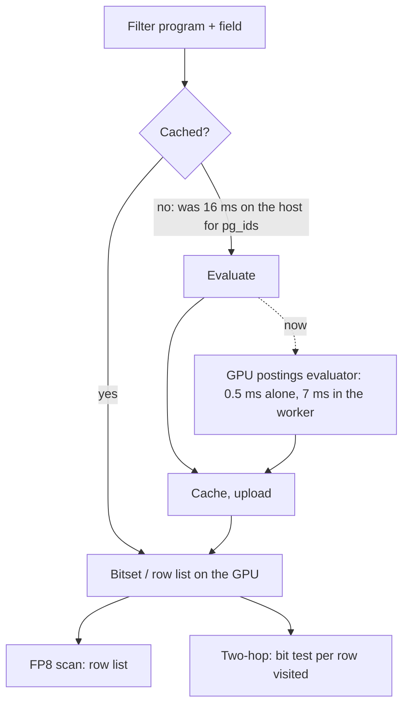
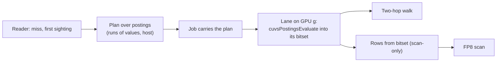

# Request scenarios on the production-size test

What the Muse benchmark's requests covered, the tools that now generate the
filters it left out, and how the three filtered routes (the FP8 scan, the
two-hop graph walk and cuVS' own filtered search) and the worker's filter
cache did on them. Measured on the 1/8 shard of
[the production-size test](ann-muse-production-scale.md) (37 groups x 46.5M
rows, 8 B200s, two copies of each group), 2026-11-21.

## What the benchmark requests covered

`scale4715/c1.frames` (200,000 requests, written by `muse_frames.py emit` from
one captured ads request) was read back with `muse_frames.py describe` and
against the index files:

- **Shape.** Six ANN searches a request, sent together, at k 300, 1000, 1000,
  1000, 600 and 300 ("today's K"; the K 30-182 file is the same requests with
  smaller k). Two of the six share field, vector and filter, so one search a
  request is an exact duplicate: the 16.6% "merged" every run reports.
- **Fields.** The captured request asked for five IVF embeddings, substituted
  at capture onto the segment's two CAGRA ones. The generator redraws each
  search's field among all fields of its dimension, so all 37 synthetic fields
  get 2.6-2.8% of the searches. The fields are scale-ups of one 9,862-item seed
  with the seed's attributes inherited: different vectors, identical filters.
- **Filters.** Every search is `pg_ids && [list] AND item_bid = value`. In the
  index all 18 single-valued columns hold one constant (`item_bid` is 83758 on
  every row), so only the multi-valued `pg_ids` (`m0`, the item's product group ids:
  9,838 groups, 4.1 an item, each group holding 0.01-0.6% of the items)
  selects anything; `pg_ids && [list]` passes items in any listed group. The file holds 70
  distinct filters, the same on every field (2,482 field and filter pairs),
  which the worker's filter cache holds after warm-up. Pass rates are 0 (3.4%
  of searches) or 0.3-5%; lists are 1-168 values where the captured request
  sent 2,582 (172 of them in the test's dictionary).
- **Dropped at capture.** The captured request's campaign-active, budget,
  pacing and holdout clauses, and `sibling_pin_promotions_count` with the score
  that read it, are realtime fields or not in the index.

Not covered by the file: other columns, OR, NOT, negated leaves, ranges,
unfiltered searches, filters outside 0.3-5%, long lists, and filters that do
not repeat.

## Tools

| Tool | What it does |
| --- | --- |
| `benchmarks/ann/muse_frames.py emit --filter-spec SPEC` | Draws the filters from templates instead of the capture: any expression of VALUES, OVERLAP, RANGE and NULL leaves (negated or not) under AND, OR and NOT; a leaf can target a pass rate (values added until the rows they hold reach a share drawn log-uniformly from a range), take N values, or be padded to a list length with values no row holds; a pool of `distinct` filters drawn uniformly or by Zipf rank. The request shape, fields, vectors and duplicates stay those of the capture. Default `emit` output is unchanged. |
| `muse_frames.py describe` | One JSON summary of a frames file: fields, k, leaves by column and operator, operators, values per leaf, duplicates and distinct filters per request, unfiltered share, and the pass-rate histogram with the share of scanned rows per bin. |
| `muse_frames.py verify` | Sends each distinct (field, filter) of a file to a running worker as operation 23 and compares the bitmap with the generator's evaluator bit for bit. |
| `muse_frames.py check` | Recall against exact answers, now through the same evaluator. |
| `benchmarks/ann/synth_attributes.py` | Writes synthetic attribute columns (flags, Zipf categoricals, log-normal values, NULL shares, by seed document or by row) into a hard-linked copy of an index tree, for filters on columns the test data lacks. Not used in the runs below. |
| `benchmarks/ann/cagra_twohop_udf_probe.cpp` | One field, one GPU: two-hop search with cached bitsets, per-query bitsets, the JIT filter UDF, or bitsets built on the GPU per call (`postings_eval.cu`). |

The evaluator was checked against `ann/common/filter.c` on 118,062 random
expressions (a C harness around `AnnFilterEvaluate`) and against a running
worker on 1,197 field and filter pairs covering every operator: no mismatch.

## Scenarios

Each changes one thing from the generator's 70-filter control (`s0`, which
keeps `c1`'s pass-rate bands and `item_bid` clause): 5,000 distinct filters
per field drawn uniformly (`s1`) or by Zipf rank (`s2`); filters passing
0.02-0.3% (`s3`), 5-8.6% (`s4`), 10-50% (`s5`, above the scan's 4M-row
limit); 20% unfiltered searches (`s6`); production-length lists padded to
2,582 values (`s7`); OR, NOT, negated and range leaves (`s8`); and runs where
0.1% or 1% of searches carry a filter never seen before (`--unique-share`).

## How the load was measured

Open loop with `agentB/muse_direct` (one thread per client): it reproduced the
published FP8-scan figure (p99 23.4 ms at 150k requests/s at K 30-182). The
epoll client (`--epoll`) adds its own queueing at these rates: the same run gave
p99 99 ms with 48 processes, 75 with 96 and 44 with 192, so the open-loop p99s
of earlier band runs were the client's. 8,192 clients up to 150k requests/s,
16,384 above; 30 s a point after a 5 s warm-up; a point counts only with no
unsent requests and a flat per-second series. Closed-loop throughput at 16,384
clients. Recall on 120 searches for the original file and 12 (four fields)
for the scenarios.

## Results

### The worker's own FP8 scan (scan-only tree)

| Scenario | Recall | Closed loop req/s | p99 at 25k / 50k / 75k / 100k req/s (ms) |
| --- | ---: | ---: | --- |
| `c1` (original) | 0.9993 | 161k | 12 / 25 / 31 / 36 |
| `s0` control | 0.9992 | 222k | 18 / 32 / 39 / 44 |
| `s3` 0.02-0.3% | 0.9994 | 242k | 2 / 10 / 17 / 22 |
| `s4` 5-8.6% | 0.9992 | 59k | 91 at 25k; holds about 46k |
| `s7` long lists | 0.9993 | 180k | 16 / 30 / 36 / 41 |
| `s8` operators | 0.9990 | 217k | 12 / 26 / 33 / 38 |
| `c1`, 0.1% new filters | 0.9993 | 154k | 27 / 48 / 61 / 72 |
| `c1`, 1% new filters | 0.9993 | 43k | 94 at 25k; holds about 43k |
| `s1` / `s2` 5,000 filters | 0.999 | collapsed | about 600 / 2,100 req/s completed |

The generator's control does not reproduce `c1` (p99 5-8 ms higher, closed
loop higher); compare scenarios with `s0`. The last three rows ran after the
5,000-filter rows had filled the cache.

### cuVS' FP8 scan, cuVS' two-hop walk and cuVS' own filtered search

Measured while the FP8 scan ran in cuVS (2026-11-21; it is back in the worker
now, and faster: see [the move back](#the-fp8-scan-back-in-the-worker)).
The cuVS-scan worker, one fresh worker a route; the scan on the scan-only tree
(on the graph tree its wide-filter runs ran out of GPU memory: graphs, FP16
rows and FP8 codes leave 42 GB a GPU), the graph routes on the tree with FP16
graphs. p99 at 25k / 50k / 100k requests/s (stock: 5k / 10k / 20k).

| Scenario | FP8 scan: recall, p99 (ms) | Two-hop: recall, p99 (ms) | Stock: recall, req/s held |
| --- | --- | --- | --- |
| `c1` | 0.998; 19 / 32 / 42 | 0.867; 3.2 / 4.2 / 5.9 | 0.53; 2.6k |
| `s0` | 0.999; 26 / 40 / 50 | 0.872; 3.2 / 4.6 / 6.6 | 0.65; 2.9k |
| `s3` 0.02-0.3% | 1.000; 3.5 / 17 / 29 | 0.990; 4.6 / 6.6 / 12.3 | 0.23; 15 |
| `s4` 5-8.6% | 0.999; 114 at 25k, holds 46k | 0.914; 3.1 / 4.3 / 5.9 | 0.41; 11k |
| `s5` 10-50% | runs failed (no graph) | 0.830; 3.4 / 4.2 / 5.5 | 0.52; 20k at 430 ms |
| `s6` 20% unfiltered | collapsed, 2.1k | 0.883; 5.8 / 10.5; not 100k | 0.74; 3.1k |
| `s7` long lists | 0.998; 24 / 38 / 49 | 0.887; 3.2 / 4.6 / 6.5 | 0.64; 3.3k |
| `s8` operators | 0.999; 20 / 34 / 45 | 0.908; 3.3 / 4.8 / 7.0 | 0.62; 2.2k |
| `s1` / `s2` 5,000 filters | collapsed, 490 / 1,650 | collapsed, 610 / 1,940 | collapsed, 520 / 2,400 |

- **FP8 scan.** Near-exact, and best on narrow filters, the only scenario
  under 30 ms at 100k requests/s. Its cost follows the rows a filter passes: at
  5-8.6% (2.3-4M rows) it holds about 46k. Against the worker's own scan on
  the same tree p99 is 6-7 ms higher at every rate, from a batch 0.2-0.25 ms
  longer (below).
- **Two-hop.** The only route under 30 ms p99 at 100k requests/s, at every
  filter width, because one graph search takes any mix of filters and nothing
  waits to be grouped. Recall at today's K is 0.83-0.91 (0.99 on narrow
  filters): its setting was chosen at K 30-182, and its 1,536-entry list leaves
  little room at k 1000.
- **Stock filtered search.** Scores every neighbour, passing or not; unusable at
  these k.
- **5,000 distinct filters.** Every route collapses the same way, and the search
  is not why: each new (field, filter) pair is evaluated on the host (about 16
  ms, `pg_ids` lists being outside the GPU evaluator until now) and cached, and
  185,000 pairs overflow the cache (346,000-514,000 evictions a run).

## Where the latency goes

`--trace` (every 64th job's arrival, queued, started, finished and replied
times) at fixed rates, today's K, median / p99 in ms:

| Rate | Worker's scan: wait, batch | cuVS scan: wait, batch |
| ---: | --- | --- |
| 25k | 5.5 / 9.3, 0.90 / 3.4 | 11.4 / 15.6, 1.10 / 3.7 |
| 50k | 14.4 / 21.7, 1.04 / 3.6 | 18.2 / 28.7, 1.25 / 3.9 |
| 100k | 17.4 / 31.7, 1.25 / 3.7 | 20.7 / 38.9, 1.49 / 4.0 |

Nearly all of a scan search's latency is waiting for a lane, about 14.5 batch
times from 50k requests/s up, for both builds; cuVS' 6-7 ms comes from its
longer batch multiplied by that wait. More lanes did not shorten it: with 192
and 288 lanes instead of 96, p99 rose (today's K at 50k: 24.0, 27.8, 35.9 ms)
and 288 lanes cut closed-loop throughput to 152k. What holds the queued
searches back is not found yet.

## Filters that do not repeat

The filter cache is keyed per index by the program's canonical form
(`--canonical-predicates`, default on): leaves on single-valued columns become
sets of the column's values, so `item_bid = 83758`, which every row holds,
folds away, and AND/OR operands are sorted and deduplicated; leaves on
multi-valued columns are kept as written. So other `pg_ids` values, the same
values in another order, or the same filter on another field are separate
entries. `--predicate-admission second` already serves a first sighting from
a transient result without caching it; the runs here left it at `all`.

Two ways to take the cache out of the path were measured on one field (46.5M
rows), 256 searches from `s1`, two-hop, K 300:

| Filter given to the search | Time a search (1 a call) | Recall |
| --- | ---: | ---: |
| Bitset cached on the GPU | 0.46 ms | 0.927 |
| JIT filter UDF (`ann/server/udf.c` interpreter, no bitset) | 4.37 ms | 0.922 |
| Bitset built on the GPU for the call from postings | 0.95 ms | 0.928 |

- **The UDF is about ten times slower.** Two-hop tests every neighbour and
  every second-hop neighbour against the filter: a bitset test is one 4-byte
  read, the UDF two offset reads, the row's `pg_ids` and a binary search of the
  filter's list for each. Results were correct (no returned row fails its
  filter, no short result) and the JIT compile cost 1.6 s once.
- **Building the bitset on the GPU costs about one search.** The postings
  evaluator (`benchmarks/ann/postings_eval.cu`) keeps each column's postings in
  device memory (`pg_ids`: 770 MB a copy), scatters the rows of a leaf's values
  into a bitset and combines leaves word by word: 0.50 ms a filter (p99 0.52,
  worst 1.1), every one of 256 identical to the host evaluator. Most of that
  went on the `item_bid` leaf, which passes every row; the worker's version
  scatters the complement of such a leaf instead.

The worker now evaluates programs with a multi-valued leaf this way
(`DevicePostingsPredicate` in `ann/server/cuvs.c`, under `--gpu-predicates`,
which already evaluated single-valued programs on the GPU row by row): the
leaves' runs are planned on the host from the attribute's sorted values and
uploaded once, a single-valued leaf passing more than half the rows is
scattered from the other values' runs and inverted, and negated comparisons
leave out the NULL rows (NULL arrays for `pg_ids`). On the two-field test tree
all 1,197 programs of an all-operator file came back identical to the
evaluator through operation 23, all on the device.

It does not end the collapse. With it, the 5,000-filter scenarios ran as
before:

| Route, scenario | Before: req/s, ms a filter evaluation | With GPU evaluation |
| --- | --- | --- |
| Two-hop, `s1` uniform | 610, about 16 (host) | 574, 7.3 |
| Two-hop, `s2` Zipf | 1,940 | 1,900, 6.6 |
| FP8 scan, `s1` uniform | 490, 27.7 | 522, 22.3 |
| FP8 scan, `s2` Zipf | 1,650 | 1,890, 18.6 |

The original file was unchanged (two-hop p99 5.8 ms, the scan 39.7 ms at 100k
requests/s) and no run had errors. An evaluation takes 7 ms here, not the
probe's 0.5 ms, and halving it moved nothing, so evaluation was not the limit.
Not yet profiled; what the counters point at:

- **The result goes through the host.** The cache lives in host memory: each
  bitset built on a GPU (5.8 MB a 46.5M-row field) is copied down, unpinned,
  and uploaded again to both copies' GPUs when a search uses it. At about
  3,400 misses a second that is some 20 GB/s down and more up.
- **The cache churns:** 360,000-480,000 evictions a run, and freeing device
  memory can stop a whole GPU. The scan also turns each bitset into a row list.
- **Per-filter bitsets cannot serve this at production rates anyway.** 185,000
  distinct (field, filter) pairs that rarely repeat mean about one new bitset a
  search: 600,000 a second at 100k requests/s, more scatter work than eight
  GPUs do, however the bitset is built. Serving such traffic needs the filter
  evaluated on the GPU that searches, handed to the search without a host copy,
  and first sightings not cached.

## Built on the searching GPU

The way out was to take first sightings off the host entirely
(`--device-transient on`, with `--predicate-admission second`). A search's
filter seen for the first time is planned on the reader thread over the
attributes' postings (the runs of each leaf's values, about 10 µs) and not
evaluated; the lane that searches it builds its bitset on its own GPU, on its
own stream, just before the search, with cuVS' `cuvsPostingsEvaluate` (in the
`chenqin/cuvs` fork, `cuvs/core/postings.h`), and nothing is cached. On a
scan-only index the plan's exact row count is taken first (one GPU pass, no
copy back), and the lane turns the bitset into the row list the FP8 scan
reads. The bitset never passes through host memory.

With 1% of searches carrying a never-seen filter (`c1`, `--unique-share
0.01`), each on a fresh worker:

| Route | Without (host evaluation) | With `--device-transient on` |
| --- | ---: | ---: |
| Two-hop | 10k req/s (p99 54 ms at 25k) | 150k req/s (p99 under 20 ms) |
| FP8 scan | 10k req/s (p99 929 ms at 25k) | 25k req/s (p99 23.7 ms)* |

Every returned key passed its filter (`muse_frames.py check` now counts the
ones that do not), recall was unchanged, and every first sighting was built in
the lane (`predicate_deferred` equals `predicate_transient`). A deferred
search joins two-hop's mixed batches like a cached one, its bitset built in
its own slot of the lane's buffer (before that, deferred searches ran one a
graph search and the same load held 125k). On the two-field
tree all 1,197 programs of the all-operator file still matched the evaluator
through operation 23 with the kernels in cuVS.

It does not help the 5,000-filter scenarios on its own: their filters repeat
just often enough that second sightings are evaluated on the host and cached,
and 185,000 (field, filter) pairs churn the cache as before.
`--device-transient always` defers every search's miss and caches nothing new,
so every search builds its own bitset:

| Route, `--device-transient always` | `c1`, 1% new filters | `s1` uniform | `s2` Zipf |
| --- | ---: | ---: | ---: |
| Two-hop | 50k req/s | 75k req/s (was 610) | 80k req/s (was 1,940) |
| FP8 scan (in cuVS then) | about 7k completed, under 10k | about 7k (was 490) | about 7k (was 1,650) |

Two-hop is limited by the builds themselves (one a search: a 5.8 MB bitset
cleared, its filter's rows scattered) and by walks whose bitsets miss L2 (see
the next section), the scan by running each search alone, after a count of
its rows on the reader thread. `on` stays the better setting while filters
mostly repeat (150k against 50k on `c1` with 1% new filters) and collapses where they don't (`s1`, `s2`:
second sightings are evaluated on the host and churn the cache); `always` is
for filters that rarely repeat.

## Profiling the 5,000-filter path

Two-hop with `--device-transient always` on `s1` and `s2`, highest rate with
p99 under 30 ms (whole node):

| Step | `s1` | `s2` | What the profile showed |
| --- | ---: | ---: | --- |
| Deferred searches built in the lane | 35k | 35k | all 8 GPUs 93-100% busy, 10 searches a batch against 55 with cached filters |
| Readers no longer wait on each other's misses | 50k | 50k | 64 readers at 75% CPU in the kernel: every miss took `evaluatingMutex` and woke waiters, for a result that is never cached |
| cuVS' build: a block per 1,024 entries of a run | 65k | 65k | the SASS of the old kernel had each entry binary-search the runs with dependent 64-bit loads |
| cuVS' build: each thread's loads issued together, one run-table copy | 70k | 70k | Nsight Compute: the build kernel 73% stalled on its global loads, 10% of DRAM bandwidth |
| cuVS' walk: a kernel for blocks of at most 256 threads | 75k | 80k | the walk at 34% occupancy, capped by 63 registers a thread; `__launch_bounds__(256, 6)` gives 40 and about 55% |

Recall stayed at 0.90 and no returned item failed its filter. At saturation
(nsys, about 60k) the walk took 62% of GPU time and the build 33%, plus a
5.8 MB clear a search. With cached filters a walk costs about 14 µs of GPU
time a search and its bitsets stay in L2; with distinct filters about 23 µs:
each in-flight query reads its own 5.8 MB bitset from DRAM.

- **The walk is latency-bound.** Nsight Compute on a batch of 64 queries:
  27% of DRAM bandwidth, 29% of SM throughput, 34% occupancy (63 registers a
  thread cap it at 50%), 66% of cycles with no eligible warp; stalls on
  global loads 36%, fixed-latency waits 16%, block barriers 14%, instruction
  fetch 10%.
- **cuVS batches a call only when query rows are as wide as the dimension.**
  At 65 dimensions (FP16 rows padded to 72) every query is its own launch; the
  worker views the rows as 72-wide vectors (`--cagra-pitch`), the probe now
  does too (`--no-pitch` restores per-query launches: 2.4k against 50k
  queries/s on one GPU).
- **Fewer registers in the walk.** cuVS declared the multi-CTA kernel for
  1,024-thread blocks, so it took 63 registers a thread whatever the block
  size. A second entry point for blocks of at most 256 threads, chosen by
  block size, takes 40: 70k to 75k (`s1`) and 80k (`s2`), and the original
  load's p99 at 150k from 19.7 to 13 ms. On one GPU, 64 queries a call: 50.3k
  to 61.7k queries/s with cached bitsets, 29.1k to 32.4k with each built.
  `(256, 8)` was a little worse; blocks of 128 or 256 threads stay slower than
  64.
- **Two-level bitsets do not pay here.** Many bits are 0, so a bitset could
  keep a summary bit per 1,024 items and words only for occupied blocks. In
  the index's item order every block is occupied (a product group's items
  are spread over the whole index), so there is nothing to skip. Items
  renumbered by product group leave 3.6% of blocks occupied and the bitset
  27 times smaller, but the walk loses its locality: 45.0k against about 50k
  queries/s on one GPU (flat bitset, same renumbering: 36.3k). The seed copies
  the test data is built from make it more clustered than production would
  be.
- **Skipping the 5.8 MB clear does not pay.** It costs 1-3 µs; unsetting the
  previous filter's ~1M bits instead costs about 12 µs.
- **A filter UDF instead of a bitset loses.** Batched, a bitset read through
  a UDF costs 25% (37.7k against 51.3k queries/s on one GPU), but testing an
  item's product groups in the walk costs about 80 µs a search against about
  15 µs to build its bitset (9.7k against 29.4k queries/s).

## Highest throughput under 30 ms p99

Each approach's best request rate with p99 under 30 ms, from an open-loop
ladder (10k, 25k, 35k, 50k, 65k, 75k, 90k, 100k, 115k, 125k, 140k, 150k, ...
requests/s, 30 s a point, the threaded client) that stops at the first point
over 30 ms or with unsent requests; recall from the scenario's check. Two-hop
on the graph tree (`--filtered-search graph`), the FP8 scan on the scan-only
tree (`--filtered-search scan`), both with the worker on cuVS'
`cuvsPostingsEvaluate`; the scan was cuVS' then, and the worker's own scan
since does better ([below](#the-fp8-scan-back-in-the-worker)). Each figure is the first scenario on a fresh worker
unless marked.

| Scenario | Two-hop: req/s, recall | FP8 scan (in cuVS then): req/s, recall |
| --- | --- | --- |
| `c1` (original) | 150k, 0.86 | 35k, 0.998 |
| `c1`, 1% new filters | 150k, 0.85 | 25k*, 0.998 |
| `s3` 0.02-0.3% | 100k, 0.989 | 75k, 0.9998 |
| `s4` 5-8.6% | 140k, 0.911 | under 10k, 0.999 |
| `s5` 10-50% | not measured | fails (out of memory) |
| `s6` 20% unfiltered | 75k, 0.882 | under 10k, 0.999 |
| `s8` operators | 125k, 0.905 | 25k*, 0.999 |
| `s1` / `s2` 5,000 filters (`always`) | 75k / 80k, 0.90 | under 10k (about 7k), 0.9997 |

\* after other scenarios on the same worker. Two-hop's `s3` figure is from a
worker with `--predicate-admission all` and no `--device-transient`; `s5` and
`s7` were not measured on fresh workers.

No clear winner: with the scan in cuVS, two-hop held several times its rate
on every load it could serve, and was the only one under 30 ms when filters
are wide or some searches unfiltered; the scan returns near-exact results
where two-hop returns 86-91% of them. The worker's own scan narrows that
([below](#the-fp8-scan-back-in-the-worker)): half of two-hop's rate on the
original load, and level with it on narrow filters (100k), at 0.9998 recall
against 0.989.
So the choice is exposed rather than made: build the index for one
(`--dtype float16` graphs, or `--scan-only --quantize fp8`) and start the
worker with `--filtered-search graph` or `--filtered-search scan`; see
[choosing the filtered search](ann-cuvs-index.md#choosing-the-filtered-search).
A worker that scanned filters of up to 500,000 rows and walked the rest held
`s3` at only 10k: those filters left two-hop's mixed batches.

## The FP8 scan back in the worker

The FP8 scan had moved into the `chenqin/cuvs` fork (a CAGRA filtered-scan
route). With two-hop ahead on every load above, it was checked once more on
the one load where it lost most, distinct filters, against a bar set
beforehand: half of two-hop's 32k queries/s a GPU when each query's bitset is
built. One query a call with its own filter (the probe's `scanc`, k 300, one
B200) reached 2.2k queries/s with one thread and 0.8k with 8-32: its
selection steps run as single thread blocks and its scoring kernel at 25%
occupancy, so most of the GPU idles a scan. Far under the bar, so the scan
went back into the worker and the cuVS route became a pull request on the
fork ([chenqin/cuvs#1](https://github.com/chenqin/cuvs/pull/1)); the fork's
`main` keeps the two-hop walk, the postings build and the walk's
256-thread kernel.

On the same tree after the move (the worker's scan on the scan-only tree,
`--filtered-search scan`; two-hop on the graph tree against the fork's `main`
without the scan), highest rate with p99 under 30 ms:

| Load | Two-hop | Worker's FP8 scan | cuVS' FP8 scan (before) |
| --- | ---: | ---: | ---: |
| `c1` (original) | 150k, p99 10 ms | 75k, p99 29 ms | 35k |
| `s3` 0.02-0.3% | not rerun (100k) | 100k or more, p99 23 ms | 75k |
| `s6` 20% unfiltered | 75k | not rerun | under 10k |
| `s1` / `s2` 5,000 filters | 75k / 80k (`always`) | under 500 (host evaluation: p99 69 ms at 500) | about 7k |

The worker's scan is faster than the port was on these loads; the earlier
same-run comparison, at fixed batch sizes, had them within 6% of each other.
It does not take `--device-transient`: its filters are evaluated on the host,
so distinct filters still cost it a host evaluation each. The worker's
ShardHits changes made during the move (cuVS' neighbours already sorted by
distance: ties slid into key order instead of a sort; their keys gathered on
the GPU) are kept: without them two-hop's `c1` queued at 140k.

## Next: FP16 rows in host memory for the FP8 scan's re-score

The FP8 scan reads its FP16 rows only to re-score the candidates it keeps, k
plus the slack a query, yet a scan-only index holds every row on the GPU: 6.7
GB a copy of a 46.5M-row, 65-dimension index, about 60 GB of each GPU for the
37 indexes at two copies. That is what ran out of room when graphs, FP16 rows
and codes shared a GPU, and what a third copy would need. Kept in pinned host
memory instead, a re-score would bring in only its candidates' rows: about
1,300 rows of 130 bytes, 170 KB a search, or 4-5 GB/s a GPU at the scan's 35k
requests/s, far below PCIe's bandwidth, in batches per call; an LRU of rows
in device memory, evicting as free memory runs low, would keep rows that
queries share. The change is in the worker's scan (re-scoring from
host-resident rows, batched) and a load option; not started.

## Not covered

- One captured request: the spread over fields and the filters' popularity
  are the generator's; how many distinct `pg_ids` lists production sends is
  unknown, and the 5,000-filter pool is an assumption.
- Columns other than `pg_ids` (the test data's are constant); synthetic ones
  with `synth_attributes.py` are next.
- The probe's absolute throughput (about 2,200 searches a second a GPU with
  bitsets) is far below the worker's two-hop route; its ratios compare like
  with like, its absolute figures do not.
