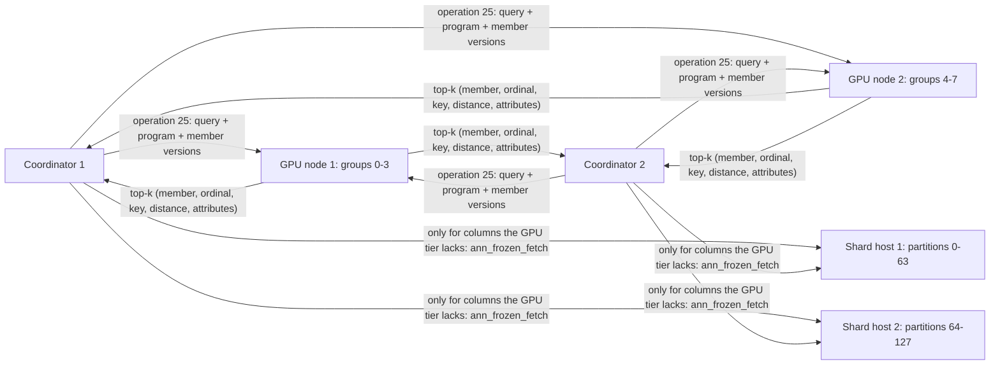

# Sharded frozen collections: plan

**Status: TODO.** Nothing in this plan is implemented yet; phases S0 to S5 below are open.

A [frozen index](ann-frozen-index.md) keeps the forward index (TID, key, vector, attributes), the inverted index (postings, bitsets, dictionaries) and the GPU export of one table on one PostgreSQL host, and every GPU node loads the whole export. This plan partitions a collection's documents across many PostgreSQL hosts the way the GPU index is already split into shards, so storage, rebuilds and fallback scoring scale with the number of hosts, while queries still cost one round trip to the GPU tier.

It follows the [immutable indexes plan](ann-immutable-indexes-plan.md) (implemented): the same freeze contract, ordinals, predicate programs and generations, applied per partition.

## 1. Objective

- A collection of billions of rows whose frozen indexes don't fit one host: partitioned by key hash across *shard hosts*, each partition frozen and indexed on its own.
- One GPU search per query across all partitions, with predicates evaluated on the GPU nodes as today (operation 22), merged into one top-k.
- Query hosts (*coordinators*) that hold no documents, so query throughput scales by adding coordinators. The [8-GPU measurements](ann-frozen-index.md#measurements) were limited by the two PostgreSQL hosts, not the GPUs.
- Partitions rebuilt, moved and added one at a time under load, with no window where a query mixes generations.
- An exact fallback when the GPU tier is unavailable: every shard answers its own top-k, the coordinator merges.

Non-goals: updates and deletes of frozen rows (new rows go to a delta, as today), cross-collection joins, Windows.

## 2. Sizing: what grows, and what to cut before sharding

Per row, measured on the 10M × 128 benchmark table (two integer attributes, one NVFP4 CAGRA shard, graph degree 32):

| Where | What | Bytes per row at d = 128 | Formula |
| --- | --- | --- | --- |
| PostgreSQL | heap (vector, key, attributes) | 585 | about 4d + 75 |
| PostgreSQL | frozen index (TID, key, **vector**, values, postings) | 576 | about 4d + 50 + 8 per attribute |
| GPU node, host memory | `vectors.f32` (exact routes, re-scoring), `keys.i64`, attributes and their inverted postings | 600 | 4d + 8 + 20 per attribute |
| GPU node, device memory | CAGRA dataset (FP32; FP16 with `--dtype float16`), graph, NVFP4 rows and scales | 720 | 4d or 2d, + 128 + d/2 + d/16 + 4 |
| Both | a cached predicate's bitmap | 0.125 | rows / 8 per predicate |

At 1 billion rows of 768 dimensions with four attributes, that is:

| Where | Total | One host holds |
| --- | --- | --- |
| PostgreSQL heap | 3.2 TB | on disk; touched only to fetch result rows |
| PostgreSQL frozen index | 3.2 TB, of which 3.1 TB is the vector copy | in memory for the fallback route |
| GPU node host memory | 3.2 TB | 2 TB on the B200 host, a quarter of it reserved for predicate results |
| GPU node device memory (FP16 dataset) | 2.1 TB | 8 × 183 GB = 1.46 TB, of which about 80% is usable |
| One cached predicate | 125 MB | 4 GB of shared cache holds 32 |

Three conclusions shape the plan:

1. **The vector copy is most of the frozen index.** Without it, the forward and inverted index of a billion rows is about 100 GB: keys, TIDs, attribute values and postings. That fits in one host's memory. Dropping or halving the copy (section 9, phase S0) is the cheapest lever and comes first.
2. **The GPU tier needs placement, not just replication.** Past about 450M rows at 768 dimensions (about 2.5B at 128), one GPU node can't hold the collection in host or device memory. Today every node listed in `ann.worker_address` is a replica that loads the whole index. Spreading members across nodes is new work (section 5).
3. **Dense bitmaps stop scaling.** At a billion rows a predicate's bitmap is 125 MB, so the caches on both sides hold a few dozen predicates. Sparse results have to be cached as ordinal lists, which the evaluator already produces below rows / 64 (phase S0).

A partition also has hard limits: the evaluator's postings are 32-bit ordinals, so at most 4.29B rows per frozen index, and `CREATE INDEX` took 29 s per 10M rows, about 50 minutes per billion on one backend. Partitions keep rebuilds short and parallel.

## 3. Architecture



- **Shard hosts** own partitions: each a frozen table with its frozen index, plus that partition's mutable delta. They answer row fetches, the fallback route, rebuilds and exports. They don't take client queries.
- **GPU nodes** load *groups*. A group is one CAGRA graph built over several partitions' exports, so a query searches as many graphs as there are GPUs, not as many as there are partitions. Each group is placed on R nodes.
- **Coordinators** hold the collection's catalog and a partitioned parent table whose partitions are `postgres_fdw` foreign tables on the shard hosts, so ordinary SQL works too. They hold no documents and can be added freely.

A query: the coordinator builds the predicate program once, sends it with the query vector to one replica of every group (one request per GPU node), merges the nodes' top-k, and returns rows. When the query reads only the key, the attributes and the distance, the coordinator never contacts a shard. Other columns come from one parallel fetch per shard host that has hits.

## 4. Partitions, members and numbering

**Partition key.** The collection is `PARTITION BY HASH (key)` with a fixed modulus P chosen for the largest expected size, for example 256, so that partitions are much smaller than hosts. PostgreSQL's own hash routes a key to its partition on every coordinator and shard. A partition is moved by changing its placement, and P is doubled by splitting each partition into remainders r and r + P, without rehashing keys between other partitions.

**Members.** Each partition's frozen index is a *member*, with its own ordinals (key rank within the partition) and its own generation, the content hash the build computes today. Moving a partition to another host and rebuilding it there gives the same generation, so the GPU tier doesn't change.

**Groups.** The builder concatenates the exports of a range of members into one group: group ordinal = member base + member ordinal, and the group's files record each member's base, row count and generation. Keys are sorted within a member, not across the group, so key-to-ordinal lookups route by partition hash first and then binary-search the member's slice. Filters are evaluated per group over the concatenated postings, which is the same evaluator over a larger ordinal space.

**Hits** carry (member, member ordinal, key, distance) and, when asked, the hit's attribute codes from the worker's `attr-*.i32`. The coordinator never rehashes a key or binary-searches an ordinal.

**Optional attribute partitioning.** When most queries pin one tenant, `PARTITION BY HASH (tenant)` lets the coordinator search only the groups whose members can match an equality or `IN` on the partition attribute, so GPU work per query stays constant as the collection grows. The cost is skew: a large tenant makes a large partition. The default stays key hash.

## 5. The GPU tier

**Loading.** `ann_collection_load(collection)` reads the catalog's placement and sends each node its groups (a new operation 24, *load group*: export paths, member table, group version). A node holding eight groups on eight GPUs looks like today's eight-shard index. Each group is searched on its GPU, and the per-shard tree merge combines them.

**Search.** A new operation 25, *search collection by predicate*, carries the query, k, the program and a member version vector: a u64 collection version in the header (a hash of every member generation and the dictionary version), plus the list of groups this node should search. The worker answers status 12 (`ANN_GENERATION`) when it doesn't hold that version, as operation 22 does for one index. The coordinator refreshes its catalog and retries.

**Placement and replication.** Each group is on R nodes (`ann_collection_group.nodes`). Per query, the coordinator picks one healthy replica per group, preferring the replica that covers the most of the query's groups, so a query costs as few node requests as possible. Heartbeats ([networked nodes](ann-networked.md#failures-and-heartbeats)) mark nodes down. A group with no healthy replica goes to the fallback (section 7) for its members only.

**Predicate caches** are keyed by group version and program hash, so rebuilding one group invalidates only its entries. Results below rows / 64 are cached as ordinal lists, not bitmaps.

**Swapping a group.** A node loads the new version next to the old one, the coordinator catalog flips in one transaction, and the old version is unloaded once no request references it. That needs headroom for one group per node: about 1/G of the node's data.

**Memory levers.** An FP16 re-scoring copy (`vectors.f16`) halves the worker's host memory per row, and `--dtype float16` already halves the device dataset.

## 6. Coordinators

**Catalog** (coordinator tables, replicated to every coordinator by physical or logical replication):

| Table | Columns |
| --- | --- |
| `ann_collection` | name, parent table, key, vector, attributes with types and collations, dictionary version, partition modulus, version |
| `ann_collection_member` | collection, partition, shard server (`postgres_fdw` server name), member generation, rows, group |
| `ann_collection_group` | collection, group, members, export paths, version, GPU nodes |

**Planner.** `set_rel_pathlist_hook` already adds the frozen route for a base relation with a frozen index. For a partitioned parent whose partitions are foreign tables registered in `ann_collection_member`, it adds `AnnCollectionSearch`: the same conditions (first `ORDER BY` key is the distance to a constant or parameter, and every restriction translates to a program over the collection's attributes), translated against the collection's attribute list instead of a local index. EXPLAIN shows the groups, nodes, and whether shard fetches are needed.

**Rows.** Covering columns (key, attributes, distance) are built from the worker's reply. Text and date attributes are decoded through the collection dictionary on the coordinator. Any other column comes from `ann_frozen_fetch(index, generation, ordinals bigint[])` on the shard host: one call per shard with hits, sent in parallel. The function reads TIDs from the index pages and rows from the heap. It errors if the member's generation differs, and the coordinator then refreshes and retries. Because the partition is frozen, a row fetched under the matching generation is the row the GPU scored, so quals need no recheck beyond the program the worker already applied.

**Connections.** Shard calls use libpq from C (`src/annshard.c`, linked like `dblink` and `postgres_fdw`), with credentials from the foreign server and user mapping, PostgreSQL's `libpq-be-fe-helpers.h` for interruptible connect and execute (PostgreSQL 16 and later), and one pooled connection per shard per backend. Calls to all shards are issued before any reply is read.

## 7. Fallback without the GPU tier

For members whose group has no healthy replica, the coordinator sends every affected shard, in parallel:

```sql
SELECT key, emb <-> $1 AS distance, <covering columns> FROM <partition> WHERE <predicate>
ORDER BY emb <-> $1 LIMIT k + offset;
```

Each shard runs the existing frozen route without a worker: an exact evaluation from its pages and CPU scoring, through its shared filter cache. The coordinator merges the per-shard lists. `postgres_fdw`'s asynchronous execution covers Append but not MergeAppend, so a plain `ORDER BY ... LIMIT` over foreign partitions would pay the shard latencies one after another. The custom scan issues the calls itself, as in section 6. Mixed queries merge GPU hits for healthy groups with shard results for the rest under one LIMIT.

## 8. Delta rows, rebuilds and rebalancing

**Delta.** Each partition is itself a small partitioned table on its shard: the frozen base plus a mutable delta, as in [new rows](ann-frozen-index.md#new-rows-a-frozen-base-and-a-delta). New rows route to their partition's delta by key hash. A query sends the GPU request and, in parallel, the delta query above to every shard with a non-empty delta, which the catalog tracks. Both results merge under one LIMIT. Deltas are re-frozen into bases on a schedule, per partition.

**Rolling rebuild.** For one partition:

1. Freeze base + delta into a new frozen table and index; the build computes the new member generation.
2. Export it and rebuild its group's graph from the group's member exports.
3. Load the new group version on its nodes next to the old one.
4. In one coordinator transaction, record the new member generation, group version and collection version. On the shard, swap partitions in one transaction.
5. Unload the old group version and drop the old partition once no request references them.

Requests carry the collection version, so a query sees either all old or all new members.

**Moving a partition** copies its frozen table to another shard host (logical replication or `COPY`) and rebuilds the index there. The generation is the same, so only `ann_collection_member.shard server` changes, and the GPU tier is untouched.

**Text dictionaries.** Codes must mean the same on every member, or one program can't be evaluated across a group. Text attributes therefore use a collection dictionary: the distinct values over all partitions, sorted in the attribute's collation, versioned in `ann_collection`. Builds take it with `WITH (frozen = true, dictionary = collection)` and fail on a value not in it. A new value means a new dictionary version and a rebuild of every member with codes after it. That is acceptable for categorical attributes. For attributes that gain values often, an *unordered* dictionary appends codes instead and supports only equality and `IN`.

## 9. Phases and gates

Each phase lands with tests, is pgindent-clean, and is benchmarked on the GPU host before pushing. Shard hosts and coordinators can be separate PostgreSQL clusters on one machine for the gates (the host already runs three).

### Phase S0: single-host levers

- A frozen index option to omit the vector copy (`vectors = heap`: the fallback and covering reads take the vector from the heap by TID) or store it as half precision (`vectors = half`).
- Ordinal-list entries in both predicate caches for results below rows / 64.
- `ann_frozen_info` reports bytes per structure.

Gates: the 10M benchmark index shrinks from 576 to about 65 B/row with `vectors = heap`. Frozen-route results and QPS are unchanged with a worker, and the fallback is measured. The caches hold sparse predicates at list size.

### Phase S1: collection catalog and partitioned build

- `ann_collection_create`, the hash-partitioned frozen build per partition, collection dictionaries, `ann_frozen_fetch`.

Gates: P = 16 partitions on one cluster build in parallel, with consistent dictionary codes. The union of partition exports equals the single-table export's rows. Fetch by ordinal equals SQL.

### Phase S2: GPU groups

- Builder `--from-export` over several member exports into one group, plus the member table.
- Operations 24 and 25, version vectors, group swap, and per-group predicate caches.

Gates: collection results equal exact SQL over the union on the CPU and cuVS backends. Eight groups on eight GPUs match today's eight-shard throughput within 10%. A group swap under load produces no errors and no mixed versions.

### Phase S3: coordinators

- `AnnCollectionSearch` over a partitioned parent with foreign partitions, covering rows from replies, and parallel libpq fetches with generation checks.

Gates: results equal exact SQL through the coordinator. Covering queries make no shard calls (EXPLAIN shows `Shard Calls: 0`). Two, then four, coordinators against one GPU node give the QPS the GPUs allow. This settles whether the PostgreSQL hosts or the GPUs are the limit.

### Phase S4: placement, failover and fallback

- Groups across GPU nodes with R replicas, replica choice per query, heartbeats, and the per-shard fallback.

Gates: stopping a GPU node under load causes no errors with R = 2. With R = 1, its groups fall back exactly, and results equal SQL. A collection larger than one node's memory loads across two.

### Phase S5: deltas, rolling rebuilds and rebalancing

Gates: rows inserted into deltas are found under one LIMIT. Rebuilding one partition under load causes no errors and no stale results. Moving a partition leaves its generation and the GPU tier unchanged. Doubling P splits partitions without moving others.

## 10. What exists and what is new

| Exists | New |
| --- | --- |
| Frozen indexes, generations, predicate programs, operations 22 and 23, both predicate caches | Collection catalog, member and group versions, collection dictionaries |
| CAGRA shards across GPUs with a tree merge; `--replicate on` | Groups built from several member exports; operations 24 and 25 |
| Several GPU nodes as replicas, with heartbeats and broadcast loads | Placement of groups across nodes and replica choice per query |
| A frozen base plus a delta under one LIMIT, on one host | The same per partition, merged on the coordinator |
| The route without a worker, exact from pages | Parallel per-shard fallback and merge |
| `ann_index_export`, `build_cuvs_index.py --from-export` | Export per partition; builder input from several exports |

## 11. What does not change

The page layouts, the freeze contract, the shared evaluator (`ann/filter.c`), the gather, grouped tensor-core and filtered CAGRA routes, the Blackwell module, RDMA lanes and the single-table frozen route all stay as they are. A collection with one partition, one group and one coordinator is today's deployment. Runtime paths stay in C. Python remains for the offline builder, tests and benchmarks.

## 12. Decisions to make

- **Partition key:** key hash (balanced, every query searches every group) or a tenant attribute (pruning, skew).
- **P and the group count:** P sized for the largest collection, groups equal to the GPUs needed for memory.
- **Dictionaries:** ordered with rebuilds on new values, or unordered with equality only, per attribute.
- **Delta placement:** per partition (default, no extra host) or one delta host (one round trip instead of one per shard, but a write bottleneck).
- **Linking libpq** into the extension for shard calls, or keeping shard calls in a separate `ann_coordinator` library.
