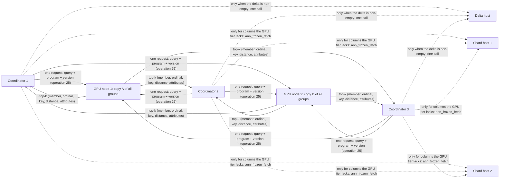

# Sharded frozen collections: plan

**Status: partly implemented.** [Collections](ann-collections.md) implement the core of phases S1 to S5: partitions frozen and exported on separate shard hosts, parts built from several partitions' exports, the collection catalog, a coordinator that holds no rows and fans one predicate search out to one replica of every part over TCP or RDMA, replica rotation and failover, and placement by an attribute that prunes parts. Phase S0's [`vectors = half` and `vectors = heap`](ann-frozen-index.md#page-layout) are implemented (576, 294 and 30 bytes per row at 10M × 128). Still open: ordinal-list cache entries, operation 25 (one request per node covering several parts, hits with attribute codes), collection dictionaries for text, per-index admission in the worker, unloading a group version, deltas and rolling rebuilds (S6), and the per-partition fallback.

A [frozen index](ann-frozen-index.md) keeps the forward index (TID, key, vector, attributes), the inverted index (postings, bitsets, dictionaries) and the GPU export of one table on one PostgreSQL host, and every GPU node loads the whole export. This plan partitions a collection across many PostgreSQL hosts and GPUs, and lays it out for the highest total query throughput: the fewest GPU searches, node requests and host round trips per query, at today's recall and exactness.

It follows the [immutable indexes plan](ann-immutable-indexes-plan.md) (implemented): the same freeze contract, ordinals, predicate programs and generations, applied per partition. Its throughput model builds on the [capacity model](cuvs-search-performance.md#2-capacity-and-latency-model).

## 1. Objective

- **Total throughput.** Queries per second of the whole system, as the minimum over its tiers (GPUs, worker processes, coordinators, links, shard hosts), with recall@10 and exactness held at today's levels on every route.
- **Capacity.** Collections of billions of rows whose frozen indexes and GPU copies don't fit one host or one GPU node.
- **One GPU node request per query** in the common case, with predicates evaluated on the GPU nodes as today (operation 22), and no shard host on the query path when the query reads only indexed columns.
- **Coordinators** that hold no documents, added to raise throughput until the GPU tier binds.
- **Rolling change.** Partitions rebuilt, moved and added one at a time under load, with no window where a query mixes generations, and an exact fallback when the GPU tier is unavailable.

Non-goals: updates and deletes of frozen rows (new rows go to a delta, as today), cross-collection joins, Windows.

## 2. Sizing: what grows, and what to cut before sharding

Per row, measured on the 10M × 128 benchmark table (two integer attributes, one NVFP4 CAGRA shard, graph degree 32):

| Where | What | Bytes per row at d = 128 | Formula |
| --- | --- | --- | --- |
| PostgreSQL | heap (vector, key, attributes) | 585 | about 4d + 75 |
| PostgreSQL | frozen index (TID, key, **vector**, values, postings) | 576 | about 4d + 50 + 8 per attribute |
| GPU node, host memory | `vectors.f32` (exact routes, re-scoring), `keys.i64`, attributes and their inverted postings | 600 | 4d + 8 + 20 per attribute |
| GPU node, device memory | CAGRA dataset (FP32; FP16 with `--dtype float16`), graph, keys, NVFP4 rows and scales | 724 | 4d or 2d, + 128 + 8 + d/2 + d/16 + 4 |
| Both | a cached predicate's bitmap | 0.125 | rows / 8 per predicate |

At 1 billion rows of 768 dimensions with four attributes, that is:

| Where | Total | One host holds |
| --- | --- | --- |
| PostgreSQL heap | 3.2 TB | on disk; touched only to fetch result rows |
| PostgreSQL frozen index | 3.2 TB, of which 3.1 TB is the vector copy | in memory for the fallback route |
| GPU node host memory | 3.2 TB | 2 TB on the B200 host, a quarter of it reserved for predicate results |
| GPU node device memory (FP16 dataset) | 2.1 TB | 8 × 183 GB = 1.46 TB, of which the memory pool may use 80% |
| One cached predicate | 125 MB | 4 GB of shared cache holds 32 |

Conclusions:

1. **The vector copy is most of the frozen index.** Without it, the forward and inverted index of a billion rows is about 100 GB. Halving it (`vectors = half`) is the throughput-safe lever: dropping it (`vectors = heap`) makes the fallback route score from scattered heap pages (section 10). Both come first, in phase S0.
2. **A GPU holds about 225M rows at d = 128** (*estimate*: the 144 GB pool over 640 B of FP32 dataset and graph per row; about 350M with an FP16 dataset, at unfiltered recall 0.985 instead of 1.0) and about 45M at d = 768. A billion rows at d = 768 needs about 23 GPUs, so three eight-GPU nodes for one copy. Today every node listed in `ann.worker_address` is a replica that loads the whole index, so placement across nodes is new work (section 6).
3. **Dense bitmaps stop scaling.** At a billion rows a predicate's bitmap is 125 MB. Sparse results have to be cached as ordinal lists, which the evaluator already produces below rows / 64 (phase S0).
4. **A partition has hard limits:** 32-bit ordinals (4.29B rows per frozen index), and `CREATE INDEX` at 29 s per 10M rows, about 50 minutes per billion on one backend.

## 3. Throughput model

Every constant here was measured on 10M × 128 rows on the B200 host, split by cores into a worker and one or two 64-core PostgreSQL clusters over loopback TCP, with pgbench on the PostgreSQL cores. Figures at other sizes are arithmetic from these constants and marked *estimate*.

```text
QPS = min( GPU tier, worker processes, coordinators, links, shard hosts )

GPU tier       = Σ GPUs 1e6 / (µs of GPU time per query on that GPU)
GPU time/query = Σ over the groups the query touches of t_route(M_g) / m
                   M_g = eligible rows in group g, m = queries sharing one scan (same filter)
worker         = R_proc per worker process × complete replica sets the query load spreads over
coordinators   = N_coord × C_coord
shard hosts    = 0 for covering queries with empty deltas and a healthy GPU tier
```

**GPU cost per touched group** ([Blackwell measurements](ann-blackwell.md#measurements), [same-filter grouping](ann-gpu-filters.md#same-filter-grouping), [scaling across GPUs and hosts](ann-gpu-filters.md#scaling-across-gpus-and-hosts)):

| Route (chosen by absolute eligible rows) | 10k rows | 100k rows | 1M rows | Exact |
| --- | --- | --- | --- | --- |
| fused NVFP4 gather, one query (2,000 < M ≤ 500,000 with a ready bitset) | 23 µs | 55 µs | 234 µs | yes |
| tensor-core scan, per query in a same-filter group of 16 (M ≤ 4,000,000) | 1.4 µs | 3.1 µs | 16 µs | yes |
| filtered CAGRA, one query (above the gather limits) | about 74 µs per graph search, nearly flat in M and graph size up to 10M rows | | | no; recall@10 0.986–1.000 on a 10M graph |
| unfiltered CAGRA | at most 2.55 µs per query (a host-bound run) | | | recall@10 1.0 at `--itopk 64` |

The scan routes cost a ≈ 21 µs per group of 16 plus b ≈ 0.22 ns per eligible row. Two consequences follow:

- **The fixed term multiplies with the groups a query touches**, and the per-row term doesn't depend on how the collection is cut. Below about 95k eligible rows per group (a / b) the fixed term dominates, so splitting a selective filter across groups costs nearly a full search per group.
- **Filtered CAGRA costs one full graph search per group touched**, whatever the filter.

**Calibration: replicate or split.** The same 10M-row index and two hosts ([scaling across GPUs and hosts](ann-gpu-filters.md#scaling-across-gpus-and-hosts)):

| Workload | 8 GPUs, index replicated | 8 GPUs, 8 shards | Replicated ÷ sharded | Model (cost per query per GPU) |
| --- | --- | --- | --- | --- |
| `ann_bitmap_search`, 0.1% | 257,759 | 58,257 | 4.42× | 8 searches of 1,250 rows instead of one |
| 1% | 140,081 | 31,942 | 4.39× | 8 × 31.0 µs against 57.1 µs: 4.3× |
| 10% | 107,813 | 13,900 | 7.76× | 8 × 74 µs against 74 µs: 8.0× |
| unfiltered | 373,948 | 218,091 | 1.71× | worker time per extra shard (8 launches, 8 syncs, 7 merges), not GPU time |

The model reproduces the measured losses within 1–3% from per-group costs. **Replicating is 4–8× better than splitting for filtered queries.**

**The worker's request ceiling.** Unfiltered end to end, one worker process reached 351–392k QPS whether it drove one GPU or eight. Changing worker cores from 96 to 128 moved it −2% to +7%, and PostgreSQL cores from 64 to 48 not at all ([scaling across GPUs and hosts](ann-gpu-filters.md#scaling-across-gpus-and-hosts), [results on 8× B200](ann-cuvs-index.md#results-on-8-nvidia-b200)). The model therefore carries **R_proc ≈ 370–390k requests per second per worker process**. Its cause is unresolved: the single scheduler queue and its mutex, a reader thread per TCP connection, loopback TCP, or the PostgreSQL hosts. Phase S3 decides it. If it's per process, several worker processes per node are a lever. If it's on the host side, coordinators are.

**Coordinators.** One 64-core host drove 176k QPS through today's frozen route (unfiltered, one GPU) and 366k through `ann_index_search`, pgbench included ([frozen measurements](ann-frozen-index.md#measurements), [same-filter grouping](ann-gpu-filters.md#same-filter-grouping)). gdb samples put 42 of 48 backend samples at 0.1% in `poll`, waiting for the worker. The plan sizes coordinators at **C_coord = 176k per 64-core host**, so about 2.2 coordinators saturate one worker process. A coordinator holding no data skips the per-row TID page read, visibility-map check, index-page reads and qual recheck of today's route, so C_coord should rise towards the function route's 366k (phase S3 measures it).

**What binds today.** After same-filter grouping, the 8-GPU node delivered 257–369k QPS on every workload while its GPUs could serve 2–8× more (8 × the one-GPU GPU ceiling: about 656k at 10% and 2.6M at 1%). The two PostgreSQL hosts and the worker process bind, not the GPUs. On one GPU, 10% filters were GPU-bound at about 90k.

**Design rules** that follow, in order of effect:

1. **Replicate before splitting.** Use the largest group that fits one GPU. Split only for memory, and add throughput with more complete copies (R), which raise every ceiling linearly.
2. **Touch one group per query when the workload allows it.** Placing rows by an attribute that queries pin (a tenant) makes GPU work per query independent of collection size. Under key hash every query touches every group.
3. **One node request per query.** A worker process holds a complete copy of the collection (up to eight GPUs), so the coordinator pays one send and parse and the fan-out stays inside one lane.
4. **Keep queries on exact scans, grouped by filter.** A same-filter group of 16 divides scan cost 10–13×. Group size follows queue depth per filter, so a few deep complete copies beat many shallow ones. Raise `--group-gather-limit` with group size to keep broad filters exact.
5. **Keep the shard hosts off the query path.** Use covering queries, one delta location instead of one per partition, and the fallback only for failures.
6. **Size coordinators to the worker processes**, then add worker processes or complete copies until the GPUs bind.
7. **Batch query vectors per statement** (B > 1) where clients allow it: every per-request cost is paid once for B searches, and B searches over one filter form a same-filter group by construction ([two kinds of batching](cuvs-search-performance.md#two-kinds-of-batching-have-different-benefits)).

## 4. Architecture



- **Shard hosts** own partitions: each a frozen table with its frozen index. They answer row fetches, the fallback, rebuilds and exports. They don't take client queries.
- **GPU nodes** hold *complete copies*: one worker process loads every group of a collection, one group per GPU. A collection too large for one node spans the fewest nodes that hold it, and a query then makes one request per node of its copy.
- **Coordinators** hold the collection's catalog and a partitioned parent table whose partitions are `postgres_fdw` foreign tables on the shard hosts, so ordinary SQL works too. They hold no documents.
- **The delta host** holds the collection's new rows until they are re-frozen (section 9).

A query: the coordinator builds the predicate program once, picks one complete copy, sends one request per node of that copy, merges the replies, and returns rows. A covering query never contacts a shard host.

## 5. Partitions, placement and groups

**Placement follows the workload.** When most queries pin an attribute with equality or `IN` (a tenant, an account, a region), the collection is placed by that attribute. A placement table in the catalog maps each value to a group: small tenants are packed together, and a tenant larger than a group gets several groups. A query whose program pins the attribute touches only those groups. Its GPU work is then a function of the tenant's rows, not the collection's: a 100k-row tenant costs 3.1 µs of GPU time in a same-filter group of 16, or 55 µs alone, at any collection size. When no attribute is pinned, placement falls back to `PARTITION BY HASH (key)` and every query touches every group.

**Partitions** are the unit of storage, rebuild and move: a fixed number P per collection (for example 256), listed or hashed by the placement attribute, each frozen and indexed on its own shard host. A tenant spanning several groups spans several partitions. P is doubled by splitting each partition into remainders r and r + P without rehashing others.

**Members.** Each partition's frozen index is a *member*, with its own ordinals (key rank within the partition) and generation. Moving a partition to another host and rebuilding it there gives the same generation, so the GPU tier doesn't change.

**Groups.** The builder concatenates the exports of the members placed in a group into one CAGRA graph: group ordinal = member base + member ordinal, and the group's files record each member's base, rows and generation. Keys are sorted within a member, not across a group. Hits carry (member, member ordinal, key, distance) and, when asked, the attribute codes from the worker's `attr-*.i32`, so the coordinator never rehashes a key or searches an ordinal.

**Group size.** As large as fits one GPU with room for a swap (section 6): fewer groups means fewer fixed costs per query under key hash, and larger same-filter groups. Route thresholds are absolute rows, so group size moves filters between routes:

| Eligible rows in a group (M_g) | One query | A same-filter group |
| --- | --- | --- |
| ≤ 2,000 | CPU exact scan | each query alone |
| ≤ 500,000 (`--bitset-gather-limit`) | fused gather scan, exact | tensor-core scan, exact |
| ≤ 4,000,000 (`--group-gather-limit`) | filtered CAGRA, approximate | tensor-core scan, exact |
| more | filtered CAGRA, approximate | batched filtered CAGRA, approximate |

At 125M rows per group, a 1% filter (1.25M rows) leaves the exact single-query route, and a 10% filter (12.5M) leaves the exact grouped route unless `--group-gather-limit` is raised. Filtered CAGRA recall above 10M rows per graph is unmeasured, so phase S2 measures it before any group above 10M rows serves filtered queries approximately.

## 6. The GPU tier

**A collection is one loaded index whose shards are its groups.** The worker already searches every shard of an index from one lane, with one launch per shard, one sync per device and a tree merge. A node-complete copy is that path with one group per GPU. Groups spanning nodes add one request per node.

**Search.** A new operation 25, *search collection by predicate*, carries the query, k, the program, the group list for that node (all of its groups under key hash, the pinned groups under attribute placement) and a u64 collection version in the header (a hash of every member generation and the dictionary version). A worker that doesn't hold that version answers status 12 (`ANN_GENERATION`), as operation 22 does, and the coordinator refreshes its catalog and retries.

**Copies and replica choice.** R complete copies, each on its own node or nodes. Per query, the coordinator picks the copy with the fewest outstanding requests from that coordinator (least outstanding, or the better of two random copies), and falls back to another copy when heartbeats mark a node down ([networked nodes](ann-networked.md#failures-and-heartbeats)). Throughput scales with R. Under attribute placement, a hot tenant's groups can get more copies than the rest (R per group, in the catalog).

**Same-filter grouping and predicate caches.** Group size follows queue depth per filter per copy, measured at 5–20 with 100 distinct 1% filters and 2.3 with 1,000 distinct 0.1% filters on one GPU. Attribute placement shrinks the distinct filters each GPU sees, and fewer deeper copies keep groups large. The worker's predicate budget is a quarter of RAM per loaded index (`--predicate-cache-mb`), so one loaded index per collection keeps one budget per node. A new predicate costs 18 ms at 10M rows (*estimate*: proportional to group rows), evaluated once per copy. `ann_frozen_precompute` warms every copy after a load or swap. Results below rows / 64 are cached as ordinal lists (phase S0).

**Swapping a group.** The new group version loads next to the old one, the catalog flips the collection version in one transaction, and the old one is unloaded once no request references it. That needs device headroom for one group per GPU being swapped: groups of at most about half a GPU (about 99M rows at d = 128 with an FP32 dataset, *estimate*), a spare GPU per node to rotate through, or, with R ≥ 2, swapping one copy at a time while the others serve (throughput drops by 1/R during the swap). Today's worker can't unload, so unloading by version is new work.

**Memory levers.** `--dtype float16` halves the device dataset (unfiltered recall 0.985 against 1.0 measured). An FP16 re-scoring copy (`vectors.f16`) would halve the worker's host memory per row.

## 7. Coordinators

**Catalog** (coordinator tables, replicated to every coordinator):

| Table | Columns |
| --- | --- |
| `ann_collection` | name, parent table, key, vector, attributes with types and collations, placement attribute, dictionary version, partition count, version |
| `ann_collection_member` | collection, partition, shard server (`postgres_fdw` server name), member generation, rows, group |
| `ann_collection_group` | collection, group, members, export paths, version, copies (nodes) |
| `ann_collection_placement` | collection, placement value, groups |
| `ann_collection_delta` | collection, delta server, rows (0 means no delta call) |

**Planner.** For a partitioned parent whose partitions are foreign tables registered in `ann_collection_member`, `set_rel_pathlist_hook` adds `AnnCollectionSearch` under the frozen route's conditions: the first `ORDER BY` key is the distance to a constant or parameter, and every restriction translates to a program over the collection's attributes. The program is built in the canonical clause order (as today), so equal filters from any coordinator hit the same cache entries. When the program pins the placement attribute, the scan resolves the groups at execution. EXPLAIN shows the groups, nodes, copy, and shard and delta calls.

**Rows.** Covering columns (key, attributes, distance) come from the reply, with text and date attributes decoded through the collection dictionary. Other columns come from `ann_frozen_fetch(index, generation, ordinals bigint[])`: one call per shard with hits, all sent before any reply is read. It errors if the member's generation changed. Frozen rows can't change, so no recheck is needed beyond the program the worker applied.

**Per query, a coordinator** builds the plan and program, sends one request per node of the chosen copy, merges the replies and builds rows from them. It skips today's per-row TID page reads, visibility checks and index-page reads.

**How many.** N_coord = target QPS ÷ C_coord, with C_coord measured in phase S3 (176k per 64-core host today, pgbench included). Coordinators to saturate one worker process: R_proc ÷ C_coord, about 2.2 today.

**Connections** to shard hosts and the delta host use libpq from C (`src/annshard.c`, linked like `dblink` and `postgres_fdw`), with credentials from the foreign server and user mapping, `libpq-be-fe-helpers.h` for interruptible calls (PostgreSQL 16 and later), and one pooled connection per server per backend.

## 8. Network and transport

| Message at d = 128, k = 10 | Bytes |
| --- | --- |
| coordinator → worker, query + program (operation 22 today) | about 588 B of payload (4d of vector, a 40-byte program) plus the 32-byte header |
| worker → coordinator, hits | 136 B with ordinals and distances today; about 250–340 B with member, key and attribute codes (*estimate*) |
| coordinator → shard, `ann_frozen_fetch` reply | about 585 B per heap row |

No key list or bitmap travels (a 1% key list was about 150 KB). At under 1 KB per request, 10 GbE carries over a million requests per second, so only 1 GbE links bind. A network round trip enters residence time, not capacity: at 512 clients and 176k QPS a query resides 2.9 ms, so a 50 µs RTT adds under 2%, and closed-loop clients need QPS × residence connections. For frames this small, TCP led RDMA in the shared-HCA runs (318k against 234k unfiltered at 1,024 clients, [RDMA](ann-networked.md#rdma-infiniband-roce)). Everything so far is loopback or one shared HCA, so phase S4 measures a real network.

**RDMA (TODO).** With requests under 1 KB, RDMA's measured win on large frames (4–8 lanes beat TCP by 3–12% on 150 KB key lists) mostly disappears, and bandwidth never binds. It can still help in three ways, none measured yet:

- **The worker's request ceiling.** If R_proc is set by kernel networking (a reader thread per TCP connection, system calls, interrupts), busy-polling RDMA lanes could raise it, and every copy's throughput with it.
- **A real network.** Across a switch, TCP pays kernel time and interrupts on both ends of every request, which loopback hides. That matters most for copies spanning nodes, where a query makes several requests.
- **Latency.** A round trip of a few µs instead of 10–50 µs shortens residence, so fewer closed-loop clients reach the same QPS. Capacity doesn't change.

It doesn't help GPU-bound workloads, shard fetches or delta calls (libpq over TCP, off the hot path), or coordinator CPU. Today's costs: one lane saturates near 95k requests per second and lanes stop scaling at about 16; spinning lanes take a core each; GPU batches were smaller (3.5 against 4.85 jobs); and each backend needs its own queue pair, at most 32,768 per worker, a limit many coordinators reach sooner.

If phase S3 shows the worker's request path binds, the work that would make RDMA pay:

- Several queries per RDMA frame, so per-request costs are paid once per frame (statements with B > 1 vectors produce these naturally).
- Queue pairs shared per coordinator instead of one per backend.
- Coordinators writing requests directly into ring buffers on the worker (RDMA write with immediate), so no lane receives them.

Phase S4 measures RDMA against TCP across a switch at the same client counts. RDMA is adopted only if it raises R_proc or cuts worker CPU per request. First measurements on [collections](ann-collections.md#measured-16m--1024-on-one-b200-host-split-into-nodes) (across two InfiniBand ports of one host): RDMA cut p99 2–8× and came within about 10% of TCP's peak for one-node queries, but its total stayed near 200–240k frames per second (about 55k per node, against 100k over TCP). Lane count, polling mode on either side, and a separate worker peer lock did not move it, and waiting lanes helped layouts with copies; queue-pair scaling (one per backend per node) and RDMA batching on the GPUs are the next things to measure.

## 9. Deltas, rebuilds and rebalancing

**One delta location per collection.** A per-partition delta would add one shard call per non-empty partition to every query. The coordinator's whole per-query cost is about 175–364 core-µs, so at P = 256 non-empty deltas a call would have to cost under 1.4 µs for the deltas not to double it. No libpq round trip is that cheap. Instead, new rows go to one delta table per collection (or per placement group under attribute placement) on a delta host. A query sends one delta call, in parallel with the GPU request, only when `ann_collection_delta.rows` > 0. The delta is scored exactly, with its own predicate, under the same LIMIT. Deltas are kept small by re-freezing them into their partitions on a schedule. A delta large enough to cost more than the GPU request becomes a small *delta group* on the GPU tier, rebuilt on that schedule (phase S6).

**Rolling rebuild.** For one partition:

1. Freeze its base plus its delta rows into a new frozen table and index, which computes the new member generation.
2. Export it and rebuild its group's graph from the group's member exports.
3. Load the new group version on every copy next to the old one, and warm its predicate caches with `ann_frozen_precompute`.
4. In one coordinator transaction, record the new member generation, group version and collection version, and remove the re-frozen rows from the delta. On the shard host, swap partitions in one transaction.
5. Unload the old group version and drop the old partition once no request references them.

Requests carry the collection version, so a query sees either all old or all new members, and no copy stops serving during a swap.

**Moving a partition** copies its frozen table to another shard host and rebuilds the index there. The generation is the same, so only the member's shard server changes, and the GPU tier is untouched. **Rebalancing groups** under attribute placement (a tenant outgrowing its group) is a placement change plus rebuilds of the groups involved.

**Text dictionaries.** Codes must mean the same on every member. Text attributes therefore use a collection dictionary: the distinct values over all partitions, sorted in the attribute's collation, versioned in `ann_collection`. Builds take it with `WITH (frozen = true, dictionary = collection)` and fail on a value not in it. A new value means a new dictionary version and rebuilds of the members whose codes change. For attributes that gain values often, an *unordered* dictionary appends codes and supports only equality and `IN`.

## 10. Fallback without the GPU tier

When no copy of a group is healthy, the coordinator sends every partition of that group's members, in parallel:

```sql
SELECT key, emb <-> $1 AS distance, <covering columns> FROM <partition> WHERE <predicate>
ORDER BY emb <-> $1 LIMIT k + offset;
```

Each shard runs the existing frozen route without a worker: exact evaluation from its pages, through its shared filter cache, and CPU scoring. The coordinator merges these lists with the GPU hits of the healthy groups under one LIMIT. `postgres_fdw` runs MergeAppend children one after another, so the custom scan issues the calls itself. The fallback keeps answers correct, not throughput: CPU scoring costs about 0.2–1.9 µs per eligible row at d = 128 (*estimate* from the worker's exact route and PostgreSQL's local route, [measured scaling](ann-networked.md#measured-scaling)), so a 1% query over a 125M-row group is 0.25–2.4 core-seconds. R ≥ 2 copies is what keeps throughput through a node loss. With `vectors = heap` the fallback would read the vector from scattered heap pages, which is why `vectors = half` is preferred.

## 11. Several collections sharing the GPU tier

A worker process has one queue, one admission budget (`--max-pending-mb`) and, if R_proc is per process, one request ceiling, shared by every index it loads. Its scheduler has no per-index fairness, and same-filter groups never span indexes. So:

- **One worker process per collection** on a node by default, each pinned to its GPUs, cores and lanes. That isolates a predicate-heavy collection from an unfiltered one, and multiplies R_proc if it is per process.
- **Place by load, not bytes.** A collection's demand is its QPS × GPU µs per query (section 3). Its copies R follow that demand, and its groups go where GPU time is free.
- **Per-index admission and lane shares** in the worker, for collections that must share a process, are new work (phase S5).
- **Statistics per group and per node** (requests, GPU µs, group sizes, cache hits, rejected requests) drive placement. Operation 8 gains them.

## 12. Worked example: a billion rows at d = 128 (estimates)

One complete copy is G = 8 groups of 125M rows, one per GPU of one node. Its device memory is about 90 GB per GPU, and its host memory about 630 GB. Each line below takes its constants from section 3:

| Workload | Route | GPU time per query | Ceiling per copy |
| --- | --- | --- | --- |
| unfiltered | CAGRA on 8 groups | at most 20 µs | about 380k: the worker process binds |
| 0.1%, hot filters (m = 16) | grouped exact scan, 125k rows per group | 25 µs | 321k |
| 0.1%, 1,000 distinct filters (m ≈ 2) | grouped exact scan | 184 µs | 43k |
| 1%, key hash | grouped exact scan, 1.25M rows per group | 154 µs | 52k |
| 1%, key hash | filtered CAGRA, 8 graph searches | 592 µs | 13.5k, recall unmeasured |
| 10%, key hash | batched filtered CAGRA, groups of about 20 | 168 µs | 48k, recall unmeasured |
| 10%, key hash, exact | grouped scan with `--group-gather-limit` raised | 1,448 µs | 5.5k |
| a 100k-row tenant, attribute placement | grouped exact scan on 1 group | 3.1 µs | worker-bound, about 380k |
| a 1M-row tenant, attribute placement | grouped exact scan on 1 group | 16 µs | worker-bound, about 380k |

Under key hash, a 1% filter over a billion rows has 10M eligible rows, so exact work per query is 100× today's, and no group count changes that. Attribute placement keeps the eligible rows per query at the tenant's size, which is why it is the default whenever queries pin one. A second copy (R = 2, two nodes) doubles every ceiling. Sixteen groups of 62.5M at R = 1 instead would give 97k at 1% against 104k for R = 2, and halve the request ceiling: splitting buys nothing over replicating. Coordinators for one copy: about 380k ÷ 176k ≈ 2–3. Groups of 125M rows leave no room for two versions on one GPU, so swaps drain one copy at a time (R ≥ 2) or use groups of about 100M.

At d = 768 a copy needs about 23 GPUs (three nodes), and per-row scan costs grow by an unmeasured factor. Phase S2 measures the kernel stages and CAGRA times at that dimension before any QPS is planned.

## 13. Phases and gates

Each phase lands with tests, is pgindent-clean, and is benchmarked on the GPU host before pushing. Coordinators, shard hosts and the delta host can be separate PostgreSQL clusters on one machine for the gates. Every throughput gate names its baseline from [frozen measurements](ann-frozen-index.md#measurements) or [scaling across GPUs and hosts](ann-gpu-filters.md#scaling-across-gpus-and-hosts).

### Phase S0: single-host levers

- `vectors = half` and `vectors = heap` frozen index options; ordinal-list entries in both predicate caches below rows / 64; `ann_frozen_info` reports bytes per structure.

Gates: the 10M index shrinks from 576 to about 320 B/row (half) and about 65 (heap). The frozen route on one GPU keeps its QPS within 5% (121k at 0.1%, 159k at 1%, 81k at 10%, 176k unfiltered), and the fallback's QPS with each option is measured. Sparse predicates are cached at list size.

### Phase S1: collection catalog and partitioned build

- `ann_collection_create`, the placement table, the partitioned frozen build, collection dictionaries, `ann_frozen_fetch`.

Gates: 16 partitions on one cluster build in parallel with consistent dictionary codes. The union of partition exports equals the single-table export's rows. Fetch by ordinal equals SQL.

### Phase S2: groups on one node

- The builder over several member exports into one group, operation 25, collection versions, group swap with unload, and per-collection predicate budgets.
- Measurements the model needs: filtered CAGRA time and recall@10 against graph size (10M to 125M rows), tensor-core scan time past 1M eligible rows, the scan's fixed cost below 10k rows, and kernel stages at d = 768.

Gates: results equal exact SQL over the union on the CPU and cuVS backends. One group replicated on eight GPUs through operation 25 reaches at least 95% of today's frozen route on eight GPUs with two hosts (201k at 0.1%, 219k at 1%, 220k at 10%, 243k unfiltered). Eight groups as one node-complete copy are measured against today's eight shards (58,257 / 31,942 / 13,900 at 0.1 / 1 / 10%), and the per-group model holds within 10%. A group swap under load produces no errors, no mixed versions, and less than a 10% QPS dip.

### Phase S3: coordinators and the request ceiling

- `AnnCollectionSearch`, covering rows from replies, parallel `ann_frozen_fetch`, and replica choice by outstanding requests.
- Measurements: C_coord without pgbench on the coordinator, and R_proc with one, two and four coordinators against one worker process, then against two processes on one node.

Gates: results equal exact SQL. Covering queries make no shard calls (EXPLAIN `Shard Calls: 0`). A coordinator serves at least 176k QPS per 64 cores on the frozen route's unfiltered workload. Adding coordinators raises total QPS until one copy reaches at least 90% of min(GPU ceiling, R_proc), and the plan records which bound it was.

### Phase S4: copies across nodes, failover and a real network

- R complete copies on separate nodes, copies spanning nodes for collections larger than one node, heartbeats, and the per-partition fallback.

Gates: two copies give at least 1.8× one copy. Stopping a node under load gives no errors and keeps at least 45% of the two-copy QPS. With R = 1, a failed group falls back exactly. A copy spanning two nodes costs the coordinator one extra request per query, and its QPS is measured. Coordinators and GPU nodes on separate machines reach at least 90% of the loopback figures, over TCP and RDMA. RDMA's R_proc and worker CPU per request are recorded against TCP's at the same client counts, which decides the RDMA work in section 8.

### Phase S5: attribute placement and sharing

- Placement by an attribute, pruning by the program, R per group for hot tenants, one worker process per collection, and per-index admission and lane shares.

Gates: tenant-pinned queries touch one group (EXPLAIN shows it), and their QPS stays within 10% when the collection grows from 10M to 80M rows over eight groups. Two collections on one node, one unfiltered at saturation and one at 1% filters, each keep at least 90% of their solo QPS when isolated by process.

### Phase S6: deltas, rolling rebuilds and rebalancing

Gates: rows inserted into the delta are found under one LIMIT. With a non-empty delta of 100k rows, QPS stays at least 90% of the empty-delta figure, and with an empty delta no delta call is made. Rebuilding one partition under load causes no errors and no stale results. Moving a partition leaves its generation and the GPU tier unchanged. Doubling P splits partitions without moving others.

## 14. What exists and what is new

| Exists | New |
| --- | --- |
| Frozen indexes, generations, predicate programs, operations 22 and 23, both predicate caches, canonical clause order | Collection catalog, placement table, collection versions and dictionaries |
| One index's shards searched from one lane with a tree merge; `--replicate on` | Groups built from several member exports; operation 25; unloading a group version |
| Several GPU nodes as replicas, heartbeats, broadcast loads | Complete copies spanning nodes, replica choice by outstanding requests, R per group |
| Same-filter grouping, the tensor-core scan, single-flight predicate evaluation | Per-collection predicate budgets, precompute on every copy after a swap |
| A frozen base plus a delta under one LIMIT, on one host | One delta location per collection, gated by its row count; a delta group on the GPU tier |
| The route without a worker, exact from pages | Parallel per-partition fallback and merge |
| One queue and admission budget per worker process | One worker process per collection; per-index admission and lane shares |

## 15. What does not change

The page layouts, the freeze contract, the shared evaluator (`ann/filter.c`), the gather, grouped tensor-core and filtered CAGRA routes, the Blackwell module, RDMA lanes and the single-table frozen route all stay as they are. A collection with one partition, one group, one copy and one coordinator is today's deployment. Runtime paths stay in C. Python remains for the offline builder, tests and benchmarks.

## 16. Decisions to make

- **Placement attribute:** which attribute, if any, most queries pin, and the largest tenant a group must hold.
- **Group size against swap headroom:** groups of half a GPU, full groups with a spare GPU per node, or full groups swapped one copy at a time.
- **Approximate routes at scale:** whether 1% and 10% filters over groups above 10M rows may use filtered CAGRA, once its recall there is measured, or stay exact at the cost in section 12.
- **Delta threshold:** how many delta rows trigger a re-freeze or a delta group.
- **Dictionaries:** ordered with rebuilds on new values, or unordered with equality only, per attribute.
- **Linking libpq** into the extension for shard and delta calls, or a separate `ann_coordinator` library.
